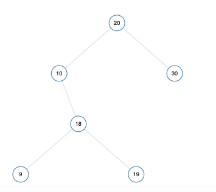
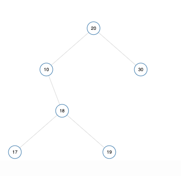

# Easy to understand 2 lines solution! O(n) with Examples and Explanation - JavaScript

**Author:** adriansky
**Votes:** 22
**Link:** [https://leetcode.com/problems/validate-binary-search-tree/solutions/783930/](https://leetcode.com/problems/validate-binary-search-tree/solutions/783930/)

---

Short and sweet:

```ts
function isValidBST(root: TreeNode|null, min = -Infinity, max = Infinity): boolean {
  if(!root) return true;
  return !(root.val <= min || root.val >= max) && isValidBST(root.left, min, root.val) && isValidBST(root.right, root.val, max);
};
```

How it works?
- If the root is `null`, then is a valid BST.
- If the root is NOT null, then we check for the following:
  - check if the current node's value is within boundaries (min/max). The intial boundaries are -/+ Infinity so any value would be valid.
  - However, for the children we start restricting the boundaries. If we go to the left subtree, then we set the current node as the `max` boundary. Similarly, if we go the right subtree, then we set the current node's value as the `min`.

Let's do some examples:

**Example 1**:

`[20,10,30,null,18,null,null,9,19]`



The recursion call will be the following:

- isValidBST(root: 20, min = -Infinity, max = Infinity)
	- isValidBST(root: 10, min = -Infinity, max = 20)
		- isValidBST(root: 18, min = 10, max = 20)
			- isValidBST(root: 9, min = 10, max = 18): `false`, though `9 < 18 < 19`, 9 is lower than the `min=10`, so it will return false.


**Example 2**:

`[20,10,30,null,18,null,null,17,19]`



The recursion call will be the following:
- isValidBST(root: 20, min: -Infinity, max: Infinity): `true`
	- isValidBST(root: 10, min = -Infinity, max = 20): `true`
		- isValidBST(root: 18, min = 10, max = 20): `true`
			- isValidBST(root: 17, min = 10, max = 18): `true`
			- isValidBST(root: 19, min = 18, max = 20): `true`
	- isValidBST(root: 30, min = 20, max = Infinity): `true`

Each one returns true so it's a valid BST.

