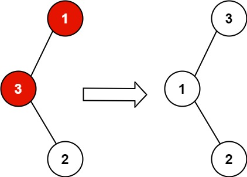
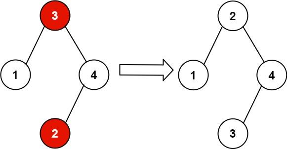

# [99. Recover Binary Search Tree](https://leetcode.com/problems/recover-binary-search-tree/)

| Category | Difficulty | Likes | Dislikes |
| :------: | :--------: | :---: | :------: |
| Algorithms | Medium | 8494 | 284 |

**Tags:** [`tree`](https://leetcode.com/tag/tree), [`depth-first-search`](https://leetcode.com/tag/depth-first-search), [`binary-search-tree`](https://leetcode.com/tag/binary-search-tree), [`binary-tree`](https://leetcode.com/tag/binary-tree)

**Companies:** `amazon`, `microsoft`, `google`, `facebook`, `medianet`, `tiktok`

## Description

You are given the `root` of a binary search tree (BST), where the values of **exactly** two nodes of the tree were swapped by mistake. *Recover the tree without changing its structure*.

 

**Example 1:**


```

Input: root = [1,3,null,null,2]
Output: [3,1,null,null,2]
Explanation: 3 cannot be a left child of 1 because 3 &gt; 1. Swapping 1 and 3 makes the BST valid.

```

**Example 2:**


```

Input: root = [3,1,4,null,null,2]
Output: [2,1,4,null,null,3]
Explanation: 2 cannot be in the right subtree of 3 because 2 &lt; 3. Swapping 2 and 3 makes the BST valid.

```

 

**Constraints:**

	- The number of nodes in the tree is in the range `[2, 1000]`.

	- `-2^31 <= Node.val <= 2^31 - 1`

 

**Follow up:** A solution using `O(n)` space is pretty straight-forward. Could you devise a constant `O(1)` space solution?

---

**Links:** [Submissions](https://leetcode.com/problems/recover-binary-search-tree/) | [Solutions](https://leetcode.com/problems/recover-binary-search-tree/)
