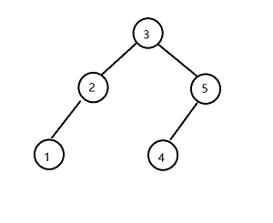

# two way for golang solution with explaination

**Author:** a2659802
**Votes:** 4
**Link:** [https://leetcode.com/problems/recover-binary-search-tree/solutions/2508744/](https://leetcode.com/problems/recover-binary-search-tree/solutions/2508744/)

---

Image we have a binary search tree as following:


if we traversal BST inorder, we will get output in order: 1 2 3 4 5 (because we visit left-self-right, and the left<self<right)

for recovering a BST, we can simply treat the problems as **how to sort an array**

for example: 
we get an array **input**: 1 5 3 4 2 6
and we want **output**: 1 2 3 4 5 6

the **first solution** for me is using sort.Ints
```golang
func recoverTree(root *TreeNode) {
	// first: get all the numbers
	allNums := make([]int, 0)
	inOrder(root, func(p *TreeNode) {
		allNums = append(allNums, p.Val)
	})
	// second: sort them
	sort.Ints(allNums)
	idx := 0
	// third: put them in order
	inOrder(root, func(p *TreeNode) {
		p.Val = allNums[idx]
		idx++
	})
}
func inOrder(root *TreeNode, doFunc func(p *TreeNode)) {
	if root == nil {
		return
	}
	inOrder(root.Left, doFunc)
	doFunc(root)
	inOrder(root.Right, doFunc)
}
```

this solution is O(nlogn) because of sorting. how can we get faster?
I read the description carefully, and find a word:"where the values of **exactly two nodes** of the tree were swapped by mistake. "

so it means we dont need to sort a total array but find these two numbers position
```text
1 5 3 4 2 6
--^-----^--
```
we traves the numbers, when find the first elem that larger than after, record the position
and record the final one. then swap them.

the **second solution**:
```golang
func recoverTree(root *TreeNode) {
	var prevNode, a, b *TreeNode
	inOrder(root, func(p *TreeNode) {
		if prevNode != nil && prevNode.Val > p.Val {
			if a == nil {
				a = prevNode
			}
			b = p
		}
		prevNode = p
	})

	swap(a, b)
}
func swap(p, q *TreeNode) {
	if p != nil && q != nil {
		p.Val, q.Val = q.Val, p.Val
	}
}
```
