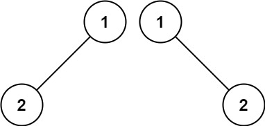
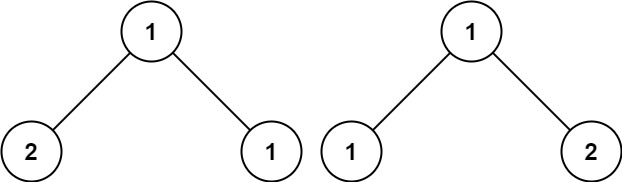

# [100. Same Tree](https://leetcode.com/problems/same-tree/)

| Category | Difficulty | Likes | Dislikes |
| :------: | :--------: | :---: | :------: |
| Algorithms | Easy | 12650 | 289 |

**Tags:** [`tree`](https://leetcode.com/tag/tree), [`depth-first-search`](https://leetcode.com/tag/depth-first-search), [`breadth-first-search`](https://leetcode.com/tag/breadth-first-search), [`binary-tree`](https://leetcode.com/tag/binary-tree)

**Companies:** `amazon`, `facebook`, `bloomberg`, `microsoft`, `google`, `linkedin`, `apple`, `adobe`, `sap`, `oracle`, `tcs`

## Description

Given the roots of two binary trees `p` and `q`, write a function to check if they are the same or not.

Two binary trees are considered the same if they are structurally identical, and the nodes have the same value.

 

**Example 1:**


```

Input: p = [1,2,3], q = [1,2,3]
Output: true

```

**Example 2:**


```

Input: p = [1,2], q = [1,null,2]
Output: false

```

**Example 3:**


```

Input: p = [1,2,1], q = [1,1,2]
Output: false

```

 

**Constraints:**

	- The number of nodes in both trees is in the range `[0, 100]`.

	- `-10^4 <= Node.val <= 10^4`

---

**Links:** [Submissions](https://leetcode.com/problems/same-tree/) | [Solutions](https://leetcode.com/problems/same-tree/)
