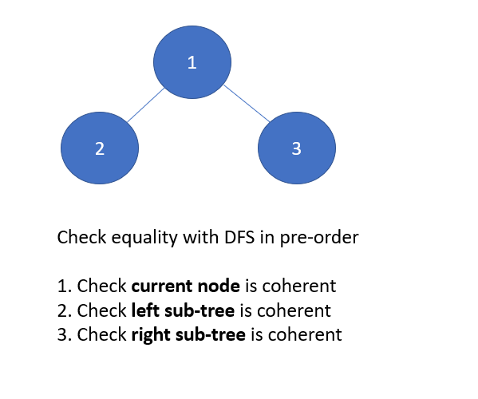

# Python/JS/Go/C++ O(n) sol by DFS [w/ Visualization ]

**Author:** brianchiang_tw
**Votes:** 13
**Link:** [https://leetcode.com/problems/same-tree/solutions/560321/](https://leetcode.com/problems/same-tree/solutions/560321/)

---

[\u4E2D\u6587\u8A73\u89E3\u89E3\u984C\u6587\u7AE0](https://vocus.cc/article/6506b5dbfd89780001901407)

O(n) sol by DFS

---

**Diagram** and **Abstract Model**:




---


**Implementation** by DFS:

Python:

```

class Solution:
    def isSameTree(self, p: TreeNode, q: TreeNode) -> bool:
        
        if p and q:
            
            # Both p and q are non-empty
            # Check equality on both subtree
            return (p.val == q.val) and self.isSameTree( p.left, q.left) and self.isSameTree( p.right, q.right )
        
        else:
            
            # At least one of them is empty
            # Check whether both p and q are empty or not
            return p == q
```

---

Javascript:

```
var isSameTree = function(p, q) {

    if( p && q ){
        
        // Both p and q are non-empty
        // Check equality on both subtree
        return p.val == q.val && isSameTree(p.left, q.left) && isSameTree(p.right, q.right);
        
    }else{
        
        // At least one of them is empty
        // Check whether both p and q are empty or not
        return p == q;    
    }
    
};
```

---

Go:

```
func isSameTree(p *TreeNode, q *TreeNode) bool {
    
    if( (p!=nil) && (q!=nil) ){
        
        // Both p and q are non-empty
        // Check equality on both subtree
        return (p.Val == q.Val) && isSameTree(p.Left, q.Left) && isSameTree(p.Right, q.Right)
        
    }else{
        
        // At least one of them is empty
        // Check whether both p and q are empty or not
        return p == q
    }
    
}
```

---

C++

```
class Solution {
public:
    bool isSameTree(TreeNode* p, TreeNode* q) {
     
        if( p && q){
            
            // Both p and q are non-empty
            // Check equality on both subtree
            return p->val == q->val && isSameTree( p->left, q->left) && isSameTree( p->right, q->right);
            
        }else{
            
            // At least one of them is empty
            // Check whether both p and q are empty or not
            return p == q;
        }
    }
};
```


---

Another **Implementation** by BFS :

```
from collections import deque

class Solution:
    def isSameTree(self, p: TreeNode, q: TreeNode) -> bool:

        def bfs( node: TreeNode ):
            
            cur_queue = [ node ] if node else [ None ]

            while cur_queue:
                
                next_queue = []
                
                for cur_node in cur_queue:
                    
                    if cur_node:
                        
                        yield cur_node.val
                        
                        next_queue.append( cur_node.left )
                        next_queue.append( cur_node.right )
                        
                    else:
                        yield None
            
                cur_queue = next_queue
            
        # -----------------------------------------------------
        
        iterator_p =  bfs( p ) 
        iterator_q =  bfs( q ) 
        
        while True:
            try:
                if next(iterator_p) != next(iterator_q):
                    return False
            except StopIteration:
                break
        
        return True
```

---


Related leetcode challenge:

[Leetcode #101 Symmetric Tree](https://leetcode.com/problems/symmetric-tree/)

[Leetcode #144 Binary Tree Preorder Traversal](https://leetcode.com/problems/binary-tree-preorder-traversal)

---

Reference:

[Wiki: Pre-order traversal of binary tree](https://en.wikipedia.org/wiki/Tree_traversal#Pre-order_(NLR))
