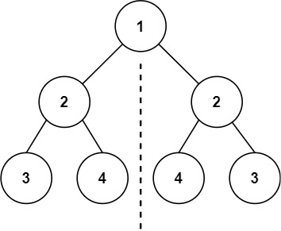
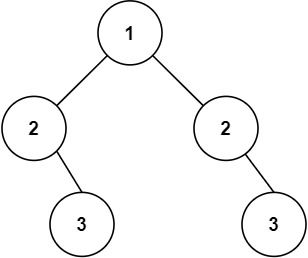

# [101. Symmetric Tree](https://leetcode.com/problems/symmetric-tree/)

| Category | Difficulty | Likes | Dislikes |
| :------: | :--------: | :---: | :------: |
| Algorithms | Easy | 16583 | 443 |

**Tags:** [`tree`](https://leetcode.com/tag/tree), [`depth-first-search`](https://leetcode.com/tag/depth-first-search), [`breadth-first-search`](https://leetcode.com/tag/breadth-first-search), [`binary-tree`](https://leetcode.com/tag/binary-tree)

**Companies:** `linkedin`, `google`, `amazon`, `yandex`, `facebook`, `bloomberg`, `adobe`, `microsoft`, `goldman-sachs`, `comcast`

## Description

Given the `root` of a binary tree, *check whether it is a mirror of itself* (i.e., symmetric around its center).

 

**Example 1:**


```

Input: root = [1,2,2,3,4,4,3]
Output: true

```

**Example 2:**


```

Input: root = [1,2,2,null,3,null,3]
Output: false

```

 

**Constraints:**

	- The number of nodes in the tree is in the range `[1, 1000]`.

	- `-100 <= Node.val <= 100`

 

**Follow up:** Could you solve it both recursively and iteratively?

---

**Links:** [Submissions](https://leetcode.com/problems/symmetric-tree/) | [Solutions](https://leetcode.com/problems/symmetric-tree/)
