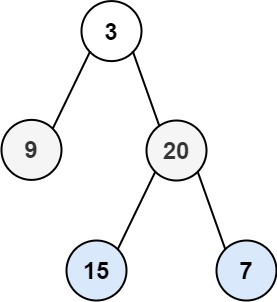

# [102. Binary Tree Level Order Traversal](https://leetcode.com/problems/binary-tree-level-order-traversal/)

| Category | Difficulty | Likes | Dislikes |
| :------: | :--------: | :---: | :------: |
| Algorithms | Medium | 16754 | 362 |

**Tags:** [`tree`](https://leetcode.com/tag/tree), [`breadth-first-search`](https://leetcode.com/tag/breadth-first-search), [`binary-tree`](https://leetcode.com/tag/binary-tree)

**Companies:** `facebook`, `amazon`, `google`, `microsoft`, `bloomberg`, `oracle`, `apple`, `palo-alto-networks`, `linkedin`, `adobe`, `walmart-labs`, `goldman-sachs`, `yandex`

## Description

Given the `root` of a binary tree, return *the level order traversal of its nodes' values*. (i.e., from left to right, level by level).

 

**Example 1:**


```

Input: root = [3,9,20,null,null,15,7]
Output: [[3],[9,20],[15,7]]

```

**Example 2:**

```

Input: root = [1]
Output: [[1]]

```

**Example 3:**

```

Input: root = []
Output: []

```

 

**Constraints:**

	- The number of nodes in the tree is in the range `[0, 2000]`.

	- `-1000 <= Node.val <= 1000`

---

**Links:** [Submissions](https://leetcode.com/problems/binary-tree-level-order-traversal/) | [Solutions](https://leetcode.com/problems/binary-tree-level-order-traversal/)
