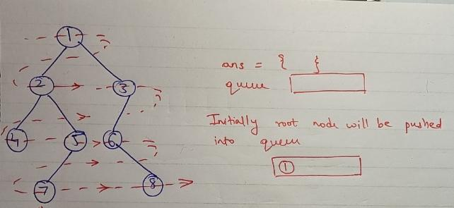
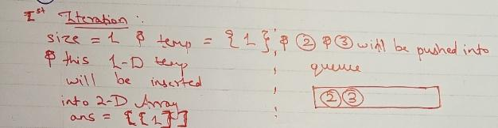
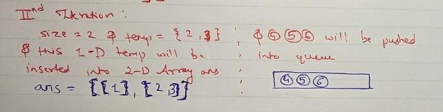
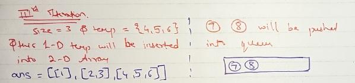
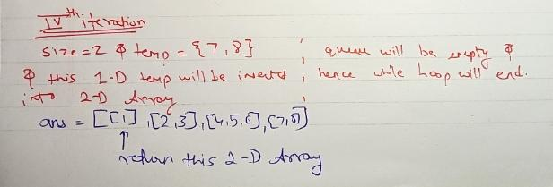

# ✅🌳 Binary Tree Level Order Traversal - In-Depth Video Solution in Hindi 🔍✨✅

**Author:** lucidd8
**Votes:** 5
**Link:** [https://leetcode.com/problems/binary-tree-level-order-traversal/solutions/6080819/](https://leetcode.com/problems/binary-tree-level-order-traversal/solutions/6080819/)

---

# Intuition
<!-- Describe your first thoughts on how to solve this problem. -->
We have to traverse the tree level wise meaning all the nodes that are on the same level will be traversed in one go.

For this traversal we will use queue data structure.

# Approach
<!-- Describe your approach to solving the problem. -->
Algorithm:

1. Declare a 2-D Array to store the visited nodes 
2. If the root is null return empty array
3. Declare a queue with TreeNode data type as we are going to store the nodes themselves into the queue
4. We will initially push the root node into the queue and then start the while loop till the queue is not empty the moment queue becomes empty we can understand that all nodes have been visited and while loop should terminate
5. We need to store the current size of the queue as the we are going to push the nodes in the queue so the size of the queue will change dynamically so to we are going to store the size inside a size variable stating till this should be traversed in this level and we are going to declare a 1-D array to store the values of the nodes at that level 
6. We are going to use a for loop from 0 to size - 1 
7. We will pop the front node from the queue after using a node pointer to point to that node 
8. We will check whether there are any left or right child of the node if yes we will push them into queue and then the node value will be push into queue
9. After the termination of the for loop we will insert that 1-D array into 2-D array representing each level
10. After all the nodes have been traversed and queue is been empty we will return the 2-D array as answer















```javascript []
class TreeNode {
    constructor(val = 0, left = null, right = null) {
        this.val = val;
        this.left = left;
        this.right = right;
    }
}

var levelOrder = function(root) {
    let ans = [];
    if (!root) return ans;

    let queue = [root];
    while (queue.length > 0) {
        let size = queue.length;
        let temp = [];
        for (let i = 0; i < size; i++) {
            let node = queue.shift();
            if (node.left) queue.push(node.left);
            if (node.right) queue.push(node.right);
            temp.push(node.val);
        }
        ans.push(temp);
    }
    return ans;
};

```
```java []
import java.util.*;

class TreeNode {
    int val;
    TreeNode left;
    TreeNode right;
    TreeNode() {}
    TreeNode(int val) { this.val = val; }
    TreeNode(int val, TreeNode left, TreeNode right) {
        this.val = val;
        this.left = left;
        this.right = right;
    }
}

class Solution {
    public List<List<Integer>> levelOrder(TreeNode root) {
        List<List<Integer>> ans = new ArrayList<>();
        if (root == null) return ans;

        Queue<TreeNode> queue = new LinkedList<>();
        queue.add(root);
        while (!queue.isEmpty()) {
            int size = queue.size();
            List<Integer> temp = new ArrayList<>();
            for (int i = 0; i < size; i++) {
                TreeNode node = queue.poll();
                if (node.left != null) queue.add(node.left);
                if (node.right != null) queue.add(node.right);
                temp.add(node.val);
            }
            ans.add(temp);
        }
        return ans;
    }
}

```
```python []
from collections import deque
from typing import List, Optional

class TreeNode:
    def __init__(self, val=0, left=None, right=None):
        self.val = val
        self.left = left
        self.right = right

class Solution:
    def levelOrder(self, root: Optional[TreeNode]) -> List[List[int]]:
        ans = []
        if not root:
            return ans

        queue = deque([root])
        while queue:
            size = len(queue)
            temp = []
            for _ in range(size):
                node = queue.popleft()
                if node.left:
                    queue.append(node.left)
                if node.right:
                    queue.append(node.right)
                temp.append(node.val)
            ans.append(temp)
        return ans

```
```ruby []
class TreeNode
    attr_accessor :val, :left, :right
    def initialize(val = 0, left = nil, right = nil)
        @val = val
        @left = left
        @right = right
    end
end

def level_order(root)
    ans = []
    return ans if root.nil?

    queue = [root]
    while !queue.empty?
        size = queue.size
        temp = []
        size.times do
            node = queue.shift
            queue.push(node.left) if node.left
            queue.push(node.right) if node.right
            temp << node.val
        end
        ans << temp
    end
    ans
end

```
```cpp []
/**
 * Definition for a binary tree node.
 * struct TreeNode {
 *     int val;
 *     TreeNode *left;
 *     TreeNode *right;
 *     TreeNode() : val(0), left(nullptr), right(nullptr) {}
 *     TreeNode(int x) : val(x), left(nullptr), right(nullptr) {}
 *     TreeNode(int x, TreeNode *left, TreeNode *right) : val(x), left(left),
 * right(right) {}
 * };
 */
class Solution {
public:
    vector<vector<int>> levelOrder(TreeNode* root) {
        vector<vector<int>> ans;
        if (root == NULL)
            return ans;

        queue<TreeNode*> q;
        q.push(root);
        while (!q.empty()) {
            int size = q.size();
            vector<int> temp;
            for (int i = 0; i < size; i++) {
                TreeNode* node = q.front();
                q.pop();
                if (node->left)
                    q.push(node->left);
                if (node->right)
                    q.push(node->right);
                temp.push_back(node->val);
            }
            ans.push_back(temp);
        }
        return ans;
    }
};
```


\uD83D\uDD14 Don\u2019t Miss Out! If you\u2019re enjoying these step-by-step coding explanations in Hindi, make sure to Subscribe to [Lucidd8](https://www.youtube.com/channel/UCPHfw-CeDZi-PwVSh1bU5jw?sub_confirmation=1) for more LeetCode solutions and C++ tutorials! \uD83D\uDE80


https://youtu.be/6ekffUzmZHI

# Complexity
- Time complexity:
<!-- Add your time complexity here, e.g. $$O(n)$$ -->
O(n)

- Space complexity:
<!-- Add your space complexity here, e.g. $$O(n)$$ -->
O(n)

# Code
```cpp []
/**
 * Definition for a binary tree node.
 * struct TreeNode {
 *     int val;
 *     TreeNode *left;
 *     TreeNode *right;
 *     TreeNode() : val(0), left(nullptr), right(nullptr) {}
 *     TreeNode(int x) : val(x), left(nullptr), right(nullptr) {}
 *     TreeNode(int x, TreeNode *left, TreeNode *right) : val(x), left(left),
 * right(right) {}
 * };
 */
class Solution {
public:
    vector<vector<int>> levelOrder(TreeNode* root) {
        vector<vector<int>> ans;
        if (root == NULL)
            return ans;

        queue<TreeNode*> q;
        q.push(root);
        while (!q.empty()) {
            int size = q.size();
            vector<int> temp;
            for (int i = 0; i < size; i++) {
                TreeNode* node = q.front();
                q.pop();
                if (node->left)
                    q.push(node->left);
                if (node->right)
                    q.push(node->right);
                temp.push_back(node->val);
            }
            ans.push_back(temp);
        }
        return ans;
    }
};
```