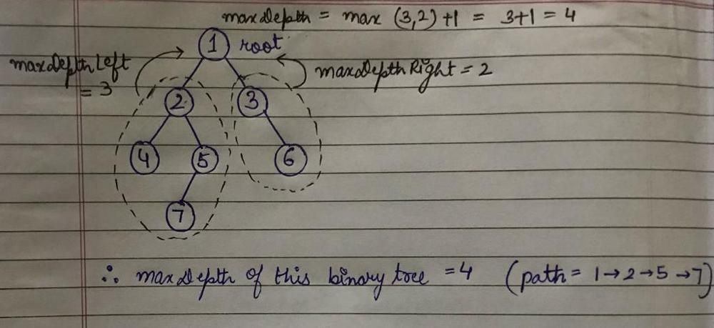
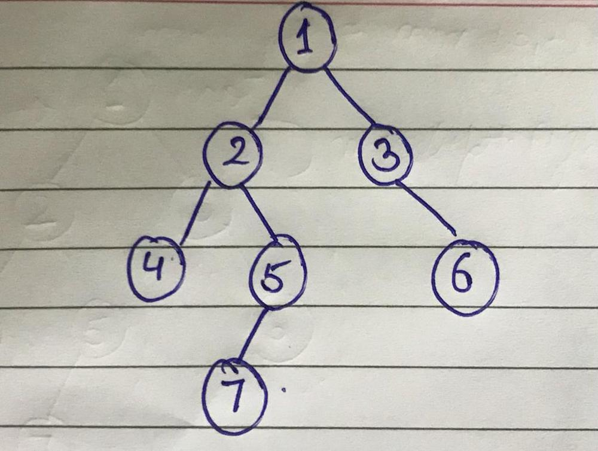
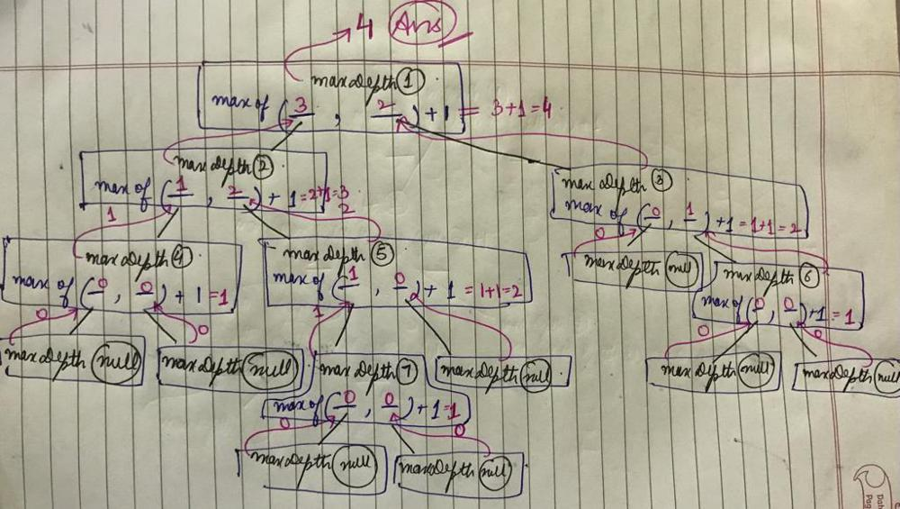

# 🚀C++ || Recursive || DFS || Example Dry Run || Well Explained

**Author:** sukhseeratkaur0226
**Votes:** 2132
**Link:** [https://leetcode.com/problems/maximum-depth-of-binary-tree/solutions/1770060/](https://leetcode.com/problems/maximum-depth-of-binary-tree/solutions/1770060/)

---

# Recursive (DFS):
Let's **redefine** the problem:
`So, the question says given the root of a binary tree, return the maximum depth of the tree. Max depth means the number of nodes along the longest path from root to farthest leaf node.`

##### Recursion:
Lets have faith in recursion and assume that we are already given the maximum depth of root's left and right subtrees by recursion.
So to fnd the maximum depth of this binary tree, we will have to take out the maximum of the 2 depths given to us by recursion, and add 1 to that to consider the current level i.e. root's level into our depth.



So basically, to find the maximum depth of the binary tree given, we mainly have to have do
```
int maxDepthLeft = maxDepth(root->left);
int maxDepthRight = maxDepth(root->right);
return max(maxDepthLeft, maxDepthRight) + 1;
```

##### Base Case:
We can easily analyse that if we are at a leaf node as root, then  its left and right subtrees will have 0 depth, and consecutively, this leaf node will have max depth of 1.

#### Example (Dry Run):
Lets take this example up and try running our approach on it.







#### Code:
```cpp
int maxDepth(TreeNode* root) {
        if(!root) return 0;
        int maxLeft = maxDepth(root->left);
        int maxRight = maxDepth(root->right);
        return max(maxLeft, maxRight)+1;
    }
```

#### Comlexity:
**TC - O(num of nodes)** as we are traversing  all the nodes of the tree
**SC - O(height of the tree)** for the recursive stack

***Plz upvote if you found the post useful***
