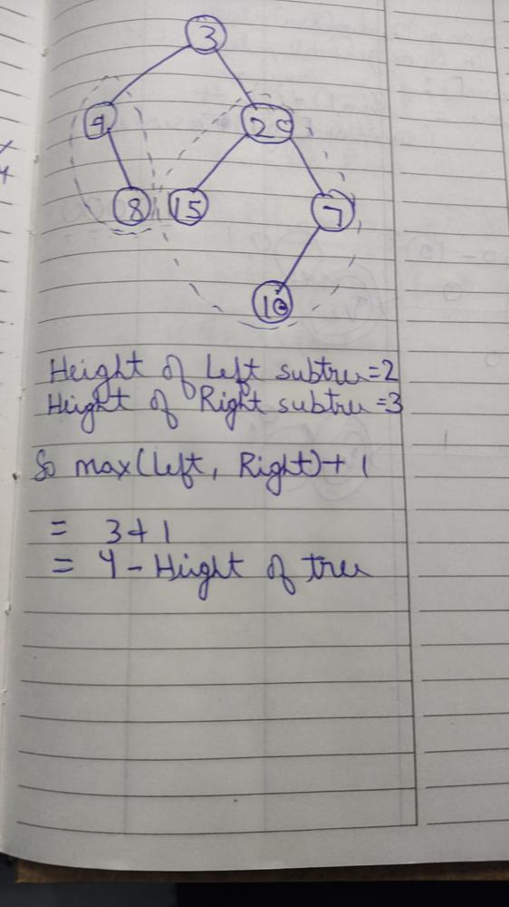

# 🔥🚀Simplest Solution🚀|| DFS ||🔥Full Explanation||🔥C++🔥|| Python3

**Author:** Naman_Ag
**Votes:** 63
**Link:** [https://leetcode.com/problems/maximum-depth-of-binary-tree/solutions/3191237/](https://leetcode.com/problems/maximum-depth-of-binary-tree/solutions/3191237/)

---

# Consider\uD83D\uDC4D
```
                    Please Upvote If You Find It Helpful
```
# Intuition
As we have to find the **Maximum Height of Tree**.
So, first we find the height of **Left Subtree and Right Subtree** of root node.
And we return the **maximum height** from **Left Subtree and Right Subtree** `+` `1`
<!-- Describe your first thoughts on how to solve this problem. -->

# Approach : DFS
    Example : root = [3,9,20,null,8,15,7,null,null,null,null,10]


<!-- Describe your approach to solving the problem. -->

# Complexity
- Time complexity: O(n) : As we are traversing each node of tree.
<!-- Add your time complexity here, e.g. $$O(n)$$ -->

- Space complexity: O(Height of tree) : Recursive stack space
<!-- Add your space complexity here, e.g. $$O(n)$$ -->

# Code
# C++
```
class Solution {
public:
    int maxDepth(TreeNode* root) {
        if(root == NULL)
            return 0;
        int lh = maxDepth(root->left);
        int rh = maxDepth(root->right);
        return max(lh, rh) + 1;
    }
};
```
# Python
```
class Solution:
    def maxDepth(self, root: Optional[TreeNode]) -> int:
        if not root:
            return 0
        leftSubtree = self.maxDepth(root.left)
        RightSubtree = self.maxDepth(root.right)
        return max(leftSubtree, RightSubtree) + 1
```
```
                            Give a \uD83D\uDC4D. It motivates me alot
```
Let's Connect On [Linkedin](https://www.linkedin.com/in/naman-agarwal-0551aa1aa/)