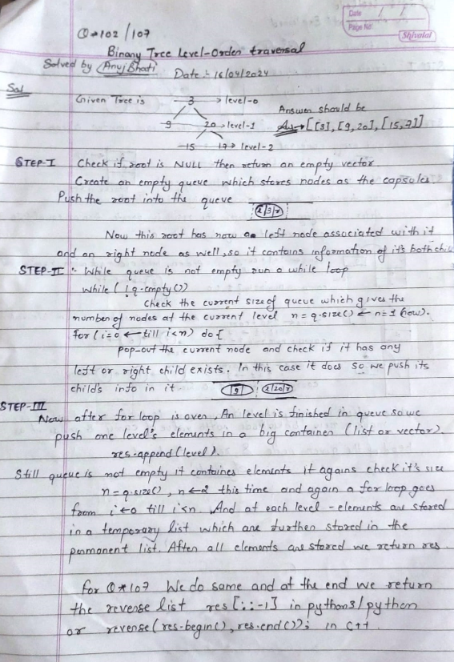

# 🔥✅✔️ Easiest C++ / Python3 🐍 / Java / C / Python 🔥☠️💀 Beats 💯 ✅✅ With Images Explained 💀

**Author:** Edwards310
**Votes:** 9
**Link:** [https://leetcode.com/problems/binary-tree-level-order-traversal-ii/solutions/5014434/](https://leetcode.com/problems/binary-tree-level-order-traversal-ii/solutions/5014434/)

---

# Intuition




# IF YOU FIND MY SOLUTION HELPFUL THAT WILL BE A GREAT HELP FOR ME .. THANKS GUY'S .
```C++ []
/**
 * Definition for a binary tree node.
 * struct TreeNode {
 *     int val;
 *     TreeNode *left;
 *     TreeNode *right;
 *     TreeNode() : val(0), left(nullptr), right(nullptr) {}
 *     TreeNode(int x) : val(x), left(nullptr), right(nullptr) {}
 *     TreeNode(int x, TreeNode *left, TreeNode *right) : val(x), left(left),
 * right(right) {}
 * };
 */
class Solution {
public:
    vector<vector<int>> levelOrderBottom(TreeNode* root) {
        if (!root)
            return {};
        vector<vector<int>> res;
        queue<TreeNode*> q;
        q.push(root);
        while (!q.empty()) {
            int n = q.size();
            vector<int> temp;
            for (int i = 0; i < n; i++) {
                TreeNode* node = q.front();
                q.pop();
                temp.push_back(node->val);
                if (node->left)
                    q.push(node->left);
                if (node->right)
                    q.push(node->right);
            }
            res.push_back(temp);
        }
        reverse(res.begin(), res.end());
        return res;
    }
};
```
```python3 []
# Definition for a binary tree node.
# class TreeNode:
#     def __init__(self, val=0, left=None, right=None):
#         self.val = val
#         self.left = left
#         self.right = right
class Solution:
    def levelOrderBottom(self, root: Optional[TreeNode]) -> List[List[int]]:
        res = []
        q = collections.deque()
        q.append(root)
        while q:
            q_len = len(q)
            level = []
            for i in range(q_len):
                node = q.popleft()
                if node is not None:
                    level.append(node.val)
                    q.append(node.left)
                    q.append(node.right)
            if level:
                res.append(level)

        return res[::-1]
```
```C []
/**
 * Definition for a binary tree node.
 * struct TreeNode {
 *     int val;
 *     struct TreeNode *left;
 *     struct TreeNode *right;
 * };
 */
/**
 * Return an array of arrays of size *returnSize.
 * The sizes of the arrays are returned as *returnColumnSizes array.
 * Note: Both returned array and *columnSizes array must be malloced, assume
 * caller calls free().
 */
void enqueue(struct TreeNode** queue, int* front, int* rear) {
    if (queue[*front]->right) {
        queue[*rear] = malloc(sizeof(struct TreeNode));
        queue[(*rear)++] = queue[*front]->right;
    }
    if (queue[*front]->left) {
        queue[*rear] = malloc(sizeof(struct TreeNode));
        queue[(*rear)++] = queue[*front]->left;
    }
    (*front)++;
}

int** levelOrderBottom(struct TreeNode* root, int* returnSize, int** returnColumnSizes) {
    int** ans = malloc(2000 * sizeof(int*));
    (*returnColumnSizes) = malloc(2000 * sizeof(int));
    if (root == NULL) {
        *returnSize = 0;
        (*returnColumnSizes)[0] = 0;
        return ans;
    }
    struct TreeNode** queue = malloc(2000 * sizeof(struct TreeNode*));
    int* widths = malloc(2000 * sizeof(int));
    int width = 1;
    int depth = 0;
    int front = 0;
    int rear = 0;
    int idx = 0;

    queue[rear] = malloc(sizeof(struct TreeNode));
    queue[rear++] = root;
    while (width) {
        width = rear - front;
        widths[depth++] = width;
        for (int i = 0; i < width; i++)
            enqueue(queue, &front, &rear);
    }
    depth -= 2;
    rear--;

    while (depth >= 0) {
        ans[idx] = malloc(widths[depth] * sizeof(int));
        for (int i = 0; i < widths[depth]; i++) {
            ans[idx][i] = queue[rear--]->val;
        }
        (*returnColumnSizes)[idx++] = widths[depth--];
    }

    free(widths);
    ans = realloc(ans, idx * sizeof(int*));
    (*returnColumnSizes) = realloc((*returnColumnSizes), idx * sizeof(int));
    *returnSize = idx;
    return ans;
}
```
```Java []
/**
 * Definition for a binary tree node.
 * public class TreeNode {
 * int val;
 * TreeNode left;
 * TreeNode right;
 * TreeNode() {}
 * TreeNode(int val) { this.val = val; }
 * TreeNode(int val, TreeNode left, TreeNode right) {
 * this.val = val;
 * this.left = left;
 * this.right = right;
 * }
 * }
 */
class Solution {
    public List<List<Integer>> levelOrderBottom(TreeNode root) {
        List<List<Integer>> res = new ArrayList<>();
        if (root == null)
            return res;
        Queue<TreeNode> q = new LinkedList<>();
        q.add(root);
        while (!q.isEmpty()) {
            int n = q.size();
            List<Integer> temp = new LinkedList<>();
            for (int i = 0; i < n; i++) {
                TreeNode node = q.poll();
                temp.add(node.val);
                if (node.left != null)
                    q.add(node.left);
                if (node.right != null)
                    q.add(node.right);
            }
            res.add(0, temp);
        }

        return res;
    }
}
```
```python []
# Definition for a binary tree node.
# class TreeNode(object):
#     def __init__(self, val=0, left=None, right=None):
#         self.val = val
#         self.left = left
#         self.right = right
class Solution(object):
    def levelOrderBottom(self, root):
        """
        :type root: TreeNode
        :rtype: List[List[int]]
        """
        if root is None:
            return []
        queue = deque()
        result = []
        queue.append(root)

        while queue:
            size = len(queue)
            temp = []
            for _ in range(size):
                cur = queue.popleft()
                temp.append(cur.val)
                if cur.left:
                    queue.append(cur.left)
                if cur.right:
                    queue.append(cur.right)
                
            result.insert(0, temp)
        
        return result
```

<!-- Describe your first thoughts on how to solve this problem. -->

# Approach
<!-- Describe your approach to solving the problem. -->

# Complexity
- Time complexity:
<!-- Add your time complexity here, e.g. $$O(n)$$ -->
     O(N + nlogn) -- TREE TRAVERSAL + REVERSE THE LIST
- Space complexity:
<!-- Add your space complexity here, e.g. $$O(n)$$ -->
     O(n) --  QUEUE STORAGE 
# Code
```
/**
 * Definition for a binary tree node.
 * struct TreeNode {
 *     int val;
 *     struct TreeNode *left;
 *     struct TreeNode *right;
 * };
 */
/**
 * Return an array of arrays of size *returnSize.
 * The sizes of the arrays are returned as *returnColumnSizes array.
 * Note: Both returned array and *columnSizes array must be malloced, assume
 * caller calls free().
 */
void enqueue(struct TreeNode** queue, int* front, int* rear) {
    if (queue[*front]->right) {
        queue[*rear] = malloc(sizeof(struct TreeNode));
        queue[(*rear)++] = queue[*front]->right;
    }
    if (queue[*front]->left) {
        queue[*rear] = malloc(sizeof(struct TreeNode));
        queue[(*rear)++] = queue[*front]->left;
    }
    (*front)++;
}

int** levelOrderBottom(struct TreeNode* root, int* returnSize, int** returnColumnSizes) {
    int** ans = malloc(2000 * sizeof(int*));
    (*returnColumnSizes) = malloc(2000 * sizeof(int));
    if (root == NULL) {
        *returnSize = 0;
        (*returnColumnSizes)[0] = 0;
        return ans;
    }
    struct TreeNode** queue = malloc(2000 * sizeof(struct TreeNode*));
    int* widths = malloc(2000 * sizeof(int));
    int width = 1;
    int depth = 0;
    int front = 0;
    int rear = 0;
    int idx = 0;

    queue[rear] = malloc(sizeof(struct TreeNode));
    queue[rear++] = root;
    while (width) {
        width = rear - front;
        widths[depth++] = width;
        for (int i = 0; i < width; i++)
            enqueue(queue, &front, &rear);
    }
    depth -= 2;
    rear--;

    while (depth >= 0) {
        ans[idx] = malloc(widths[depth] * sizeof(int));
        for (int i = 0; i < widths[depth]; i++) {
            ans[idx][i] = queue[rear--]->val;
        }
        (*returnColumnSizes)[idx++] = widths[depth--];
    }

    free(widths);
    ans = realloc(ans, idx * sizeof(int*));
    (*returnColumnSizes) = realloc((*returnColumnSizes), idx * sizeof(int));
    *returnSize = idx;
    return ans;
}
```
# Please upvote if it's useful

