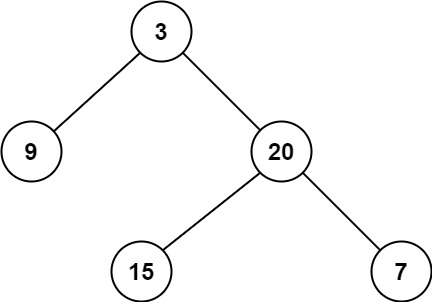

# [111. Minimum Depth of Binary Tree](https://leetcode.com/problems/minimum-depth-of-binary-tree/)

| Category | Difficulty | Likes | Dislikes |
| :------: | :--------: | :---: | :------: |
| Algorithms | Easy | 7740 | 1358 |

**Tags:** [`tree`](https://leetcode.com/tag/tree), [`depth-first-search`](https://leetcode.com/tag/depth-first-search), [`breadth-first-search`](https://leetcode.com/tag/breadth-first-search), [`binary-tree`](https://leetcode.com/tag/binary-tree)

**Companies:** `google`, `facebook`, `amazon`, `bloomberg`, `microsoft`

## Description

Given a binary tree, find its minimum depth.

The minimum depth is the number of nodes along the shortest path from the root node down to the nearest leaf node.

**Note:** A leaf is a node with no children.

 

**Example 1:**


```

Input: root = [3,9,20,null,null,15,7]
Output: 2

```

**Example 2:**

```

Input: root = [2,null,3,null,4,null,5,null,6]
Output: 5

```

 

**Constraints:**

	- The number of nodes in the tree is in the range `[0, 10^5]`.

	- `-1000 <= Node.val <= 1000`

---

**Links:** [Submissions](https://leetcode.com/problems/minimum-depth-of-binary-tree/) | [Solutions](https://leetcode.com/problems/minimum-depth-of-binary-tree/)
