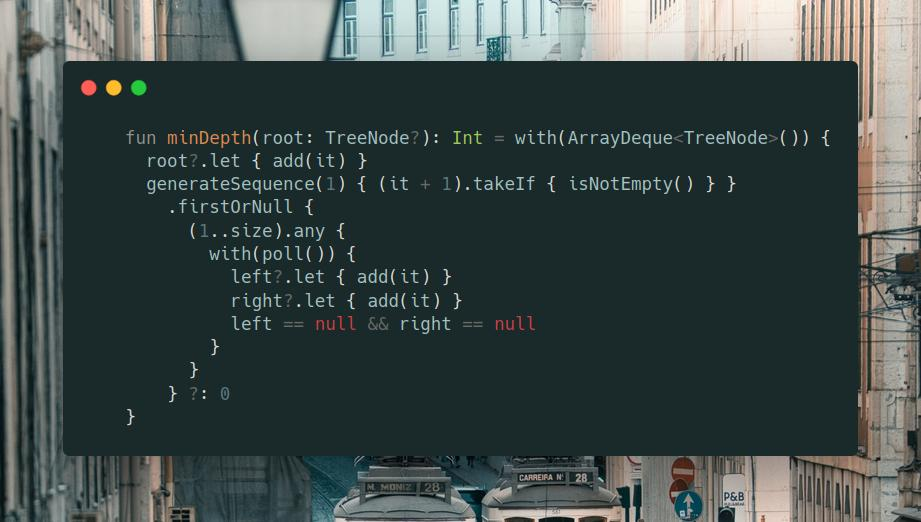

# Kotlin | BFS

**Author:** SamoylenkoDmitry
**Votes:** 2
**Link:** [https://leetcode.com/problems/minimum-depth-of-binary-tree/solutions/3743369/](https://leetcode.com/problems/minimum-depth-of-binary-tree/solutions/3743369/)

---



#### Join me on Telegram
https://t.me/leetcode_daily_unstoppable/271
#### Problem TLDR
Count nodes in the shortest path from root to leaf
#### Intuition
* remember to count `nodes`, not `edges`
* `leaf` is a node without children
* use BFS or DFS

#### Approach
Let's use BFS
#### Complexity
- Time complexity:
$$O(n)$$
- Space complexity:
$$O(n)$$
#### Code
```

    fun minDepth(root: TreeNode?): Int = with(ArrayDeque<TreeNode>()) {
      root?.let { add(it) }
      generateSequence(1) { (it + 1).takeIf { isNotEmpty() } }
        .firstOrNull {
          (1..size).any {
            with(poll()) {
              left?.let { add(it) }
              right?.let { add(it) }
              left == null && right == null
            }
          }
        } ?: 0
    }

```