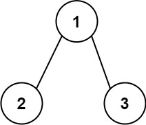

# [129. Sum Root to Leaf Numbers](https://leetcode.com/problems/sum-root-to-leaf-numbers/)

| Category | Difficulty | Likes | Dislikes |
| :------: | :--------: | :---: | :------: |
| Algorithms | Medium | 8561 | 155 |

**Tags:** [`tree`](https://leetcode.com/tag/tree), [`depth-first-search`](https://leetcode.com/tag/depth-first-search), [`binary-tree`](https://leetcode.com/tag/binary-tree)

**Companies:** `facebook`, `amazon`, `google`, `microsoft`, `servicenow`

## Description

You are given the `root` of a binary tree containing digits from `0` to `9` only.

Each root-to-leaf path in the tree represents a number.

	- For example, the root-to-leaf path `1 -> 2 -> 3` represents the number `123`.

Return *the total sum of all root-to-leaf numbers*. Test cases are generated so that the answer will fit in a **32-bit** integer.

A **leaf** node is a node with no children.

 

**Example 1:**


```

Input: root = [1,2,3]
Output: 25
Explanation:
The root-to-leaf path 1-&gt;2 represents the number 12.
The root-to-leaf path 1-&gt;3 represents the number 13.
Therefore, sum = 12 + 13 = 25.

```

**Example 2:**


```

Input: root = [4,9,0,5,1]
Output: 1026
Explanation:
The root-to-leaf path 4-&gt;9-&gt;5 represents the number 495.
The root-to-leaf path 4-&gt;9-&gt;1 represents the number 491.
The root-to-leaf path 4-&gt;0 represents the number 40.
Therefore, sum = 495 + 491 + 40 = 1026.

```

 

**Constraints:**

	- The number of nodes in the tree is in the range `[1, 1000]`.

	- `0 <= Node.val <= 9`

	- The depth of the tree will not exceed `10`.

---

**Links:** [Submissions](https://leetcode.com/problems/sum-root-to-leaf-numbers/) | [Solutions](https://leetcode.com/problems/sum-root-to-leaf-numbers/)
