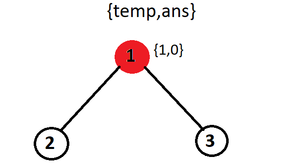
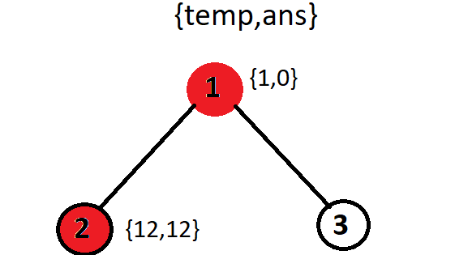
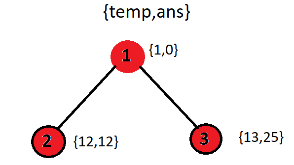
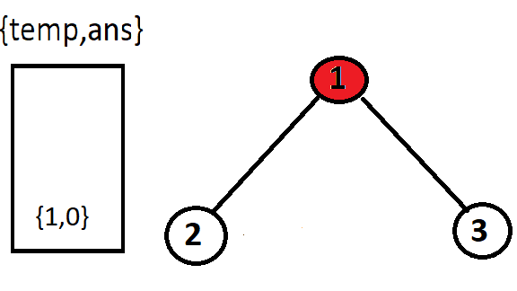
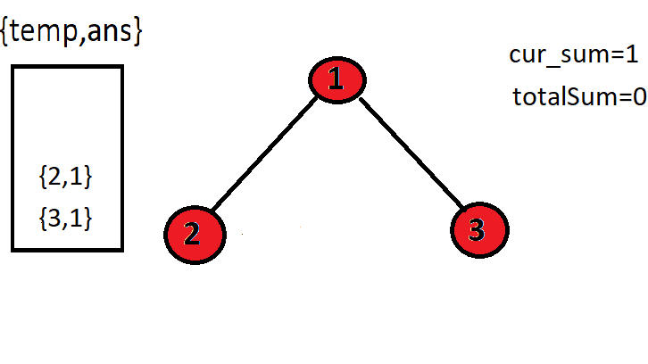
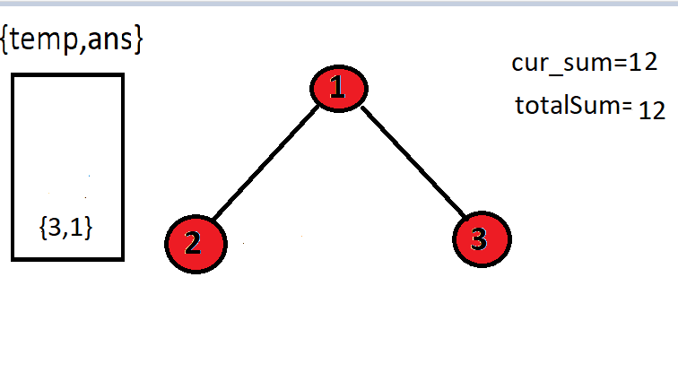
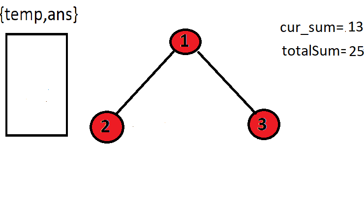

# [C++]Recursive and Iterative Simple explanation | 100% faster | O(N)

**Author:** sahibpratap
**Votes:** 49
**Link:** [https://leetcode.com/problems/sum-root-to-leaf-numbers/solutions/1555932/](https://leetcode.com/problems/sum-root-to-leaf-numbers/solutions/1555932/)

---

**Problem statement :** We have to find the sum of all the root to leaf number nodes.

**Approach**
1.Recursive
2.Iterative

**Time and space complexity**
1. Recursive :  Time complexity: O(N)  Auxiliary space: O(H)  H-> height of tree
2. Iterative : Time Complexity: O(N)  Space complexity: O(N) ->Stack

**Recursive**
# Digramatical representation




# Code
```
class Solution {
public:
    void findSum(TreeNode* root, int temp ,int &ans){
        if(root==NULL){
            return;
        }
        temp=temp*10+root->val;
        //If reached the last node
        if(root->left==NULL and root->right==NULL){
            ans+=temp;
        }
        findSum(root->left,temp,ans);
        findSum(root->right,temp,ans);
    }
    int sumNumbers(TreeNode* root) {
        if(root==NULL){
            return 0;
        }
        //Output
        int ans=0;
        findSum(root,0,ans);
        return ans;
    }
};
```

**Iterative**
# Diagramatical representation





# Code
```
class Solution {
public:
    int sumNumbers(TreeNode* root) {
        int totalSum=0;
        stack<pair<TreeNode*,int>> stck;
        stck.push({root,0});
        while(!stck.empty()){
            pair<TreeNode*,int> p=stck.top();
            stck.pop();
            TreeNode* cur_node=p.first;
            int cur_sum=p.second;
            if(cur_node!=NULL){
                cur_sum=cur_sum*10+cur_node->val;
                if(cur_node->left==NULL and cur_node->right==NULL){
                    totalSum+=cur_sum;
                }
                else{
                    if(cur_node->right){
                        stck.push({cur_node->right,cur_sum});
                    }
                    if(cur_node->left){
                        stck.push({cur_node->left,cur_sum});
                    }
                }
            }
        }
        return totalSum;
    }
};
```

Thank you so much for reading my article, if you like then please like and share.


