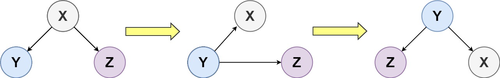
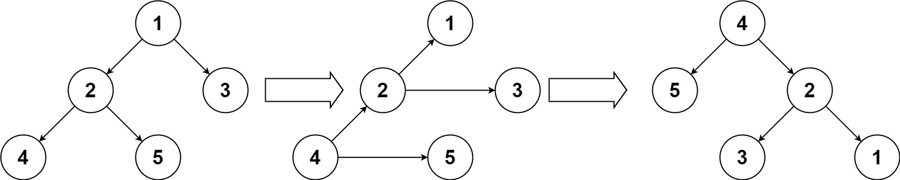

# [156. Binary Tree Upside Down](https://leetcode.com/problems/binary-tree-upside-down/)

| Category | Difficulty | Likes | Dislikes |
| :------: | :--------: | :---: | :------: |
| Algorithms | Medium | 299 | 387 |

**Tags:** [`tree`](https://leetcode.com/tag/tree), [`depth-first-search`](https://leetcode.com/tag/depth-first-search), [`binary-tree`](https://leetcode.com/tag/binary-tree)

**Companies:** `linkedin`

## Description

Given the `root` of a binary tree, turn the tree upside down and return *the new root*.

You can turn a binary tree upside down with the following steps:

	- The original left child becomes the new root.

	- The original root becomes the new right child.

	- The original right child becomes the new left child.



The mentioned steps are done level by level. It is **guaranteed** that every right node has a sibling (a left node with the same parent) and has no children.

 

**Example 1:**


```

Input: root = [1,2,3,4,5]
Output: [4,5,2,null,null,3,1]

```

**Example 2:**

```

Input: root = []
Output: []

```

**Example 3:**

```

Input: root = [1]
Output: [1]

```

 

**Constraints:**

	- The number of nodes in the tree will be in the range `[0, 10]`.

	- `1 <= Node.val <= 10`

	- Every right node in the tree has a sibling (a left node that shares the same parent).

	- Every right node in the tree has no children.

---

**Links:** [Submissions](https://leetcode.com/problems/binary-tree-upside-down/) | [Solutions](https://leetcode.com/problems/binary-tree-upside-down/)
