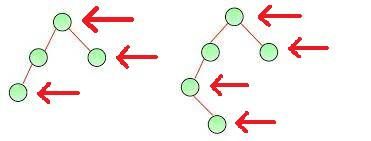
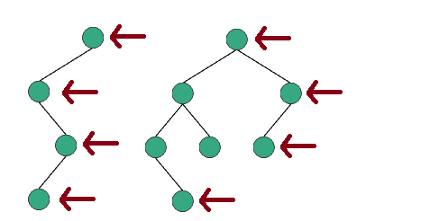

# ✔️ C++ || PYTHON || EXPLAINED || ; ]

**Author:** karan_8082
**Votes:** 176
**Link:** [https://leetcode.com/problems/binary-tree-right-side-view/solutions/2266055/](https://leetcode.com/problems/binary-tree-right-side-view/solutions/2266055/)

---

**UPVOTE IF HELPFuuL**

The demand of the question is to get the nodes at ```i``` level that are rightmost.
Any nodes left to that would not be included in answer.


**Level order traversal could help but that uses addtional space for the QUEUE**

**APPROACH with no extra space**

Maintain an array / vector.

* TRAVERSAL -> **ROOT ->RIGHT -> LEFT** This is the way traversal is done in array so that rightmost node at ```i``` level is visited first.

* When at ```i``` level, check in array/vector, if there is an element already present at index```i``` in the array. 
[ index represents the level in tree ]->**[element at index i is rightmost node at level i]**
* If at that level, *element is present,*, just continue the traversal.
* Else if no element is present at index ```i``` -> add that node to answer ```[res]``` at the ```i``` index.





**UPVOTE IF HELPFuuL**

**C++**
```
class Solution {
public:
    
    vector<int> solve(TreeNode* root, vector<int> res, int lvl){
        if (root==NULL){
            return res;
        }
        if (res.size()==lvl){                 // root
            res.push_back(root->val);
        }
        res = solve(root->right , res , lvl + 1);     // right
        res = solve(root->left , res , lvl + 1);       // left
        return res;
    }
    
    vector<int> rightSideView(TreeNode* root) {
        vector<int> res;
        res = solve( root , res , 0 );
        return res;
    }
};
```
**UPVOTE IF HELPFuuL**
**PYTHON**
```
class Solution:
    def rightSideView(self, root: Optional[TreeNode]) -> List[int]:
        
        def solve(root, lvl):
        	if root:
        		if len(res)==lvl:
        			res.append(root.val)
        		solve(root.right, lvl + 1)
        		solve(root.left, lvl + 1)
        	return 

        res = []
        solve(root,0)
        return res
```


