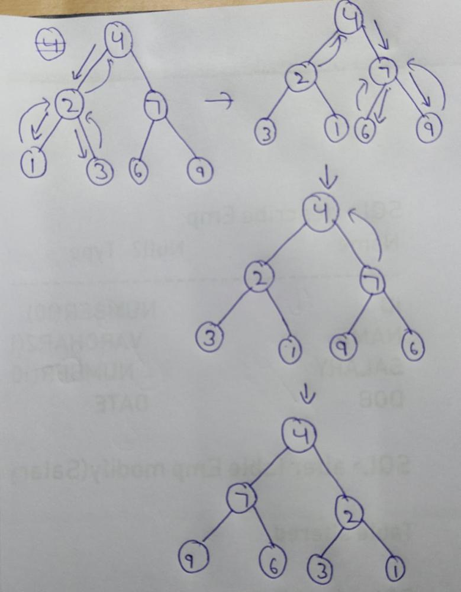

# 🔥0 ms🔥|🚀Simplest Solution🚀||🔥Full Explanation||🔥C++🔥|| Python3

**Author:** Naman_Ag
**Votes:** 549
**Link:** [https://leetcode.com/problems/invert-binary-tree/solutions/3199238/](https://leetcode.com/problems/invert-binary-tree/solutions/3199238/)

---

# Consider\uD83D\uDC4D
```
                    Please Upvote If You Find It Helpful
```
# Intuition
In this question we have to **Invert the binary tree**.
So we use **Post Order Treversal** in which first we go in **Left subtree** and then in **Right subtree** then we return back to **Parent node**.
When we come back to the parent node we **swap** it's **Left subtree** and **Right subtree**.
<!-- Describe your first thoughts on how to solve this problem. -->

# Approach


<!-- Describe your approach to solving the problem. -->

# Complexity
- Time complexity: O(N) 
<!-- Add your time complexity here, e.g. $$O(n)$$ -->

- Space complexity: O(N) Recursive stack space
<!-- Add your space complexity here, e.g. $$O(n)$$ -->

# Code
```C++ []
class Solution {
public:
    TreeNode* invertTree(TreeNode* root) {
        // Base Case
        if(root==NULL)
            return NULL;
        invertTree(root->left); //Call the left substree
        invertTree(root->right); //Call the right substree
        // Swap the nodes
        TreeNode* temp = root->left;
        root->left = root->right;
        root->right = temp;
        return root; // Return the root
    }
};
```
```python []
class Solution:
    def invertTree(self, root: Optional[TreeNode]) -> Optional[TreeNode]:
        if not root: #Base Case
            return root
        self.invertTree(root.left) #Call the left substree
        self.invertTree(root.right)  #Call the right substree
        # Swap the nodes
        root.left, root.right = root.right, root.left
        return root # Return the root
```


```
                        Give a \uD83D\uDC4D. It motivates me alot
```
Let's Connect On [Linkedin](https://www.linkedin.com/in/naman-agarwal-0551aa1aa/)