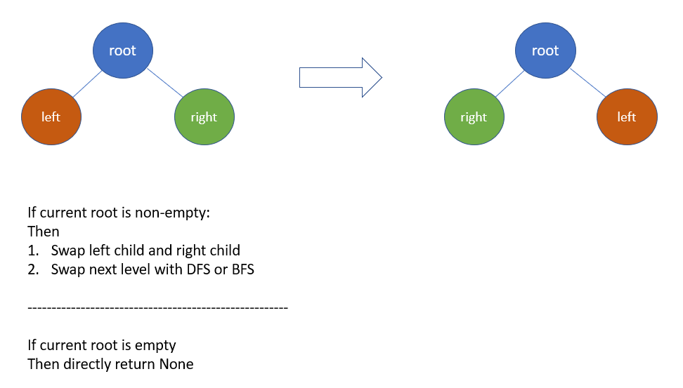

# Python/JS/Java/Go/C++ O(n) by DFS [w/ Visualization]

**Author:** brianchiang_tw
**Votes:** 32
**Link:** [https://leetcode.com/problems/invert-binary-tree/solutions/664132/](https://leetcode.com/problems/invert-binary-tree/solutions/664132/)

---

O(n) by DFS

---

**Illustration** and **Visualization**:



---

**Implementation** by DFS on demand:

**Python**:

```
# Definition for a binary tree node.
# class TreeNode:
#     def __init__(self, val=0, left=None, right=None):
#         self.val = val
#         self.left = left
#         self.right = right

class Solution:
    def invertTree(self, root: TreeNode) -> TreeNode:
        
        if root:
            # General case:
            
            # invert child node of current root
            root.left, root.right = root.right, root.left
            
            # invert subtree with DFS
            self.invertTree( root.left )
            self.invertTree( root.right )
            
            return root
        
        else:
            # Base case:
            # empty tree
            
            return None
```

---

**Java**:

```
class Solution {
    public TreeNode invertTree(TreeNode root) {
        if( root != null ){

            // General case:
            // invert child node of current root
            TreeNode temp = root.left;
            root.left = root.right;
            root.right = temp;

            // invert subtree with DFS
            invertTree(root.left);
            invertTree(root.right);
            return root;

        }else{

            // Base case:
            // empty tree or empty node
            return null; 
        }
    }
}
```

---

**Javascript**:

```
var invertTree = function(root) {
    
    if( root != null ){
        
        // General case:
        // invert child node of current root
        [root.left, root.right] = [root.right, root.left];
        
        // invert subtree with DFS
        invertTree(root.left);
        invertTree(root.right);
        return root;
        
    }else{
        
        // Base case:
        // empty tree or empty node
        return null; 
    }
    
};
```

---

**Go**:

```
func invertTree(root *TreeNode) *TreeNode {
    
    if root != nil{
        
        // General cases:
        // invert child node of current root
        root.Left, root.Right = root.Right, root.Left
        
        // invert subtree with DFS
        invertTree(root.Left)
        invertTree(root.Right)
        return root
        
    }else{
        
        // Base case:
        // empty tree or empty node
        return nil
    }
    
}
```

---

**C++**

```
class Solution {
public:
    TreeNode* invertTree(TreeNode* root) {
        
        if( root != nullptr ){
            
            // General case:
            // invert child node of current root
            swap( root->left, root->right );
            
            // invert subtree with DFS
            invertTree(root->left);
            invertTree(root->right);
            
            return root;
            
        }else{
            
            // Base case:
            // empty tree or empty node
            return nullptr;
        }
    }
};
```

---

**Implementation** by BFS on demand:

```
from collections import deque    
    
class Solution:
    def invertTree(self, root: TreeNode) -> TreeNode:        
        
        traversal_queue = deque([root]) if root else None
        
		# lanuch BFS, aka level-order-traversal to carry out invertion
        while traversal_queue:
            
            cur_node = traversal_queue.popleft()
            
			# Invert child node of current node
            cur_node.left, cur_node.right = cur_node.right, cur_node.left
            
			# push left child into queue to invert left subtree
            if cur_node.left:
                traversal_queue.append( cur_node.left )
            
			# push right child into queue to invert right subtree
            if cur_node.right:
                traversal_queue.append( cur_node.right )                
        
        return root
```