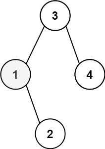
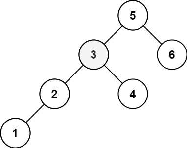

# [230. Kth Smallest Element in a BST](https://leetcode.com/problems/kth-smallest-element-in-a-bst/)

| Category | Difficulty | Likes | Dislikes |
| :------: | :--------: | :---: | :------: |
| Algorithms | Medium | 12499 | 256 |

**Tags:** [`tree`](https://leetcode.com/tag/tree), [`depth-first-search`](https://leetcode.com/tag/depth-first-search), [`binary-search-tree`](https://leetcode.com/tag/binary-search-tree), [`binary-tree`](https://leetcode.com/tag/binary-tree)

**Companies:** `google`, `uber`, `microsoft`, `amazon`, `oracle`, `facebook`, `bloomberg`, `linkedin`, `apple`, `cisco`, `expedia`

## Description

Given the `root` of a binary search tree, and an integer `k`, return *the* `k^th` *smallest value (**1-indexed**) of all the values of the nodes in the tree*.

 

**Example 1:**


```

Input: root = [3,1,4,null,2], k = 1
Output: 1

```

**Example 2:**


```

Input: root = [5,3,6,2,4,null,null,1], k = 3
Output: 3

```

 

**Constraints:**

	- The number of nodes in the tree is `n`.

	- `1 <= k <= n <= 10^4`

	- `0 <= Node.val <= 10^4`

 

**Follow up:** If the BST is modified often (i.e., we can do insert and delete operations) and you need to find the kth smallest frequently, how would you optimize?

---

**Links:** [Submissions](https://leetcode.com/problems/kth-smallest-element-in-a-bst/) | [Solutions](https://leetcode.com/problems/kth-smallest-element-in-a-bst/)
