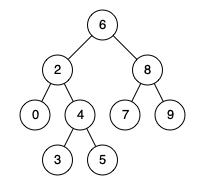

# [235. Lowest Common Ancestor of a Binary Search Tree](https://leetcode.com/problems/lowest-common-ancestor-of-a-binary-search-tree/)

| Category | Difficulty | Likes | Dislikes |
| :------: | :--------: | :---: | :------: |
| Algorithms | Medium | 12089 | 351 |

**Tags:** [`tree`](https://leetcode.com/tag/tree), [`depth-first-search`](https://leetcode.com/tag/depth-first-search), [`binary-search-tree`](https://leetcode.com/tag/binary-search-tree), [`binary-tree`](https://leetcode.com/tag/binary-tree)

**Companies:** `linkedin`, `amazon`, `google`, `facebook`, `bloomberg`, `microsoft`, `apple`, `yandex`, `twitter`

## Description

Given a binary search tree (BST), find the lowest common ancestor (LCA) node of two given nodes in the BST.

According to the definition of LCA on Wikipedia: &ldquo;The lowest common ancestor is defined between two nodes `p` and `q` as the lowest node in `T` that has both `p` and `q` as descendants (where we allow **a node to be a descendant of itself**).&rdquo;

 

**Example 1:**


```

Input: root = [6,2,8,0,4,7,9,null,null,3,5], p = 2, q = 8
Output: 6
Explanation: The LCA of nodes 2 and 8 is 6.

```

**Example 2:**


```

Input: root = [6,2,8,0,4,7,9,null,null,3,5], p = 2, q = 4
Output: 2
Explanation: The LCA of nodes 2 and 4 is 2, since a node can be a descendant of itself according to the LCA definition.

```

**Example 3:**

```

Input: root = [2,1], p = 2, q = 1
Output: 2

```

 

**Constraints:**

	- The number of nodes in the tree is in the range `[2, 10^5]`.

	- `-10^9 <= Node.val <= 10^9`

	- All `Node.val` are **unique**.

	- `p != q`

	- `p` and `q` will exist in the BST.

---

**Links:** [Submissions](https://leetcode.com/problems/lowest-common-ancestor-of-a-binary-search-tree/) | [Solutions](https://leetcode.com/problems/lowest-common-ancestor-of-a-binary-search-tree/)
