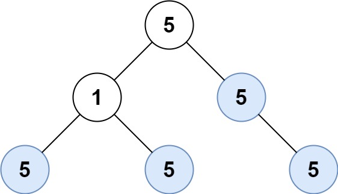

# [250. Count Univalue Subtrees](https://leetcode.com/problems/count-univalue-subtrees/)

| Category | Difficulty | Likes | Dislikes |
| :------: | :--------: | :---: | :------: |
| Algorithms | Medium | 1244 | 453 |

**Tags:** [`tree`](https://leetcode.com/tag/tree), [`depth-first-search`](https://leetcode.com/tag/depth-first-search), [`binary-tree`](https://leetcode.com/tag/binary-tree)

**Companies:** `6sense`, `amazon`, `google`, `zeta`

## Description

Given the `root` of a binary tree, return *the number of **uni-value** **subtrees*.

A **uni-value subtree** means all nodes of the subtree have the same value.

 

**Example 1:**


```

Input: root = [5,1,5,5,5,null,5]
Output: 4

```

**Example 2:**

```

Input: root = []
Output: 0

```

**Example 3:**

```

Input: root = [5,5,5,5,5,null,5]
Output: 6

```

 

**Constraints:**

	- The number of the node in the tree will be in the range `[0, 1000]`.

	- `-1000 <= Node.val <= 1000`

---

**Links:** [Submissions](https://leetcode.com/problems/count-univalue-subtrees/) | [Solutions](https://leetcode.com/problems/count-univalue-subtrees/)
