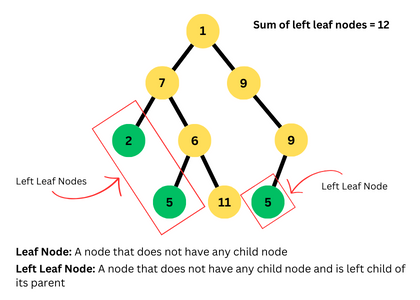

# 💯Faster✅💯Lesser✅Detailed Explaination🎯BFS🔥DFS🧠Step-by-Step Explaination✅Python🐍Java🍵C++

**Author:** Mohammed_Raziullah_Ansari
**Votes:** 99
**Link:** [https://leetcode.com/problems/sum-of-left-leaves/solutions/5019128/](https://leetcode.com/problems/sum-of-left-leaves/solutions/5019128/)

---

# \uD83D\uDE80 Hi, I'm [Mohammed Raziullah Ansari](https://leetcode.com/Mohammed_Raziullah_Ansari/), and I'm excited to share solution to this question with detailed explanation:

# \uD83C\uDFAFProblem Explaination: 
- We are given `root` of a binary tree.
- We need to find the the sum of all left leaves.



# \uD83E\uDDE0Thinking Behind the Solution:
To solve this question we need to traverse tree, now common traversal techniques to traverse are BFS and DFS. Now you are supposed to identify which traversal method is best suited for the problem of finding the sum of left leaves in a binary tree, DFS (Depth-First Search) is indeed more straightforward and suitable than BFS (Breadth-First Search).

Here's why DFS is preferred for this task:

- **Depth-First Search (DFS)**: DFS is suitable for problems where you need to explore as far as possible along each branch before backtracking which perfectly alings to our problem requirement.

- **Breadth-First Search (BFS)**: BFS can also be used be solve this problem but with little more modifications to the traversal. Because BFS is ideal for finding the shortest path in an unweighted graph or tree. It explores all the neighboring nodes at the present depth before moving on to nodes at the next depth level. 

# 1\uFE0F\u20E3 Approach(BFS\uD83E\uDD13)\u2705:

1. **Initialize Variables**:
   - Use a queue for BFS traversal. Each element in the queue will be a tuple `(node, is_left)`, where `node` is the current node being processed and `is_left` is a boolean flag indicating whether the node is a left child of its parent.
   - Initialize `total_sum` to accumulate the sum of values of left leaves.

2. **BFS Traversal**:
   - Start BFS traversal from the root of the tree.
   - Enqueue the root node along with the `is_left` flag set to `False` (since the root has no parent).
   
3. **Iterate Using Queue**:
   - While the queue is not empty:
     - Dequeue a node from the front of the queue.
     - Check if the dequeued node is a left leaf:
       - If `is_left` is `True` (indicating the node is a left child) and the node is a leaf (i.e., both left and right children are `None`), add the value of this node to `total_sum`.
     - Enqueue the left child (if exists) with `is_left` set to `True`.
     - Enqueue the right child (if exists) with `is_left` set to `False`.

4. **Process Each Node**:
   - For each node dequeued from the queue:
     - If the node is a left leaf (i.e., `is_left` is `True` and it has no children), add its value to `total_sum`.
     - Enqueue the left and right children (if they exist) into the queue with appropriate `is_left` flags.

5. **Return the Result**:
   - After processing all nodes using BFS, return `total_sum` which represents the sum of values of all left leaves in the binary tree.


# Let's walkthrough\uD83D\uDEB6\uD83C\uDFFB\u200D\u2642\uFE0F the implementation process with an example for better understanding\uD83C\uDFAF:
Let's walk through the code step by step with the input `root = [3,9,20,null,null,15,7]`.
 - Iteration 1:
```
Queue: [['3', 'False']]
Total Sum: 0
```
- Iteration 2:
```
Queue: [['3', 'False'], ['9', 'True']]
Total Sum: 0
```

- Iteration 3:
```
Queue: [['3', 'False'], ['9', 'True'], ['20', 'False']]
Total Sum: 9
```

- Iteration 4:
```
Queue: [['3', 'False'], ['9', 'True'], ['20', 'False'], ['15', 'True']]
Total Sum: 9
```

- Iteration 5:
```
Queue: [['3', 'False'], ['9', 'True'], ['20', 'False'], ['15', 'True'], ['7', 'False']]
Total Sum: 24
```

- Final Total Sum
```
Total Sum: 24
```

# Code\uD83D\uDC69\uD83C\uDFFB\u200D\uD83D\uDCBB(BFS\uD83E\uDD13):
```Python []
class Solution:
    def sumOfLeftLeaves(self, root: Optional[TreeNode]) -> int:
        if not root:
            return 0
        
        queue = deque([(root, False)])  # (node, is_left)
        total_sum = 0
        
        while queue:
            node, is_left = queue.popleft()
            
            if is_left and not node.left and not node.right:
                total_sum += node.val
            
            if node.left:
                queue.append((node.left, True))
            if node.right:
                queue.append((node.right, False))
        
        return total_sum
```
```Java []
class Solution {
    public int sumOfLeftLeaves(TreeNode root) {
        if (root == null) {
            return 0;
        }
        
        Queue<Pair<TreeNode, Boolean>> queue = new LinkedList<>();
        queue.offer(new Pair<>(root, false));  // (node, is_left)
        int totalSum = 0;
        
        while (!queue.isEmpty()) {
            Pair<TreeNode, Boolean> pair = queue.poll();
            TreeNode node = pair.getKey();
            boolean isLeft = pair.getValue();
            
            if (isLeft && node.left == null && node.right == null) {
                totalSum += node.val;
            }
            
            if (node.left != null) {
                queue.offer(new Pair<>(node.left, true));
            }
            if (node.right != null) {
                queue.offer(new Pair<>(node.right, false));
            }
        }
        
        return totalSum;
    }
}
```
```C++ []
class Solution {
public:
    int sumOfLeftLeaves(TreeNode* root) {
        if (!root) {
            return 0;
        }
        
        queue<pair<TreeNode*, bool>> q;  // (node, is_left)
        q.push({root, false});
        int totalSum = 0;
        
        while (!q.empty()) {
            auto [node, isLeft] = q.front();
            q.pop();
            
            if (isLeft && !node->left && !node->right) {
                totalSum += node->val;
            }
            
            if (node->left) {
                q.push({node->left, true});
            }
            if (node->right) {
                q.push({node->right, false});
            }
        }
        
        return totalSum;
    }
};
```
# 2\uFE0F\u20E3 Approach(DFS\uD83D\uDE0E)\u2705:

1. **DFS Traversal**:
   - We'll use a recursive DFS approach to traverse the binary tree.
   - Start by defining a recursive function `dfs(node, isLeft)`, where `node` represents the current node being processed and `isLeft` indicates whether the current node is a left child of its parent.

2. **Base Case**:
   - If the `node` is `None` (i.e., we've reached a leaf beyond the tree), return `0`.

3. **Leaf Node Check**:
   - Check if the current `node` is a leaf node (i.e., it has no left or right child).
   - If it's a leaf node and is a left child (`isLeft` is `True`), return its value (`node.val`) as it's a left leaf. If not a left leaf (`isLeft` is `False`), return `0`.

4. **Recursive Calls**:
   - If the current `node` is not a leaf node, recursively calculate the sum of left leaves for its left and right children.
   - For the left child (`node.left`), call `dfs(node.left, True)` to indicate that it's a left child.
   - For the right child (`node.right`), call `dfs(node.right, False)` as it's not a left child.

5. **Sum Calculation**:
   - In the `dfs` function, sum up the results of left leaves (`leftSum`) and right nodes (`rightSum`) obtained from the recursive calls.
   - The final result for the current node will be `leftSum + rightSum`.

6. **Initial Call**:
   - Start the traversal by calling `dfs(root, False)`, where `root` is the root of the binary tree and `False` indicates that the root is not a left child.

# Let's walkthrough\uD83D\uDEB6\uD83C\uDFFB\u200D\u2642\uFE0F the implementation process with an example for better understanding\uD83C\uDFAF:
Let's walk through the code step by step with the input `root = [3,9,20,null,null,15,7]`.
- Iteration 1: 
```
{'Node Value': 3, 'Is Left Child': False, 'Path': [3]}
```
- Iteration 2: 
```
{'Node Value': 9, 'Is Left Child': True, 'Path': [3, 9]}
```
- Iteration 3: 
```
{'Node Value': 20, 'Is Left Child': False, 'Path': [3, 20]}
```
- Iteration 4: 
```
{'Node Value': 15, 'Is Left Child': True, 'Path': [3, 20, 15]}
```
- Iteration 5: 
```
{'Node Value': 7, 'Is Left Child': False, 'Path': [3, 20, 7]}
```
- Final sum of Left Leaves:
```
Sum of Left Leaves: 24
```
# Code\uD83D\uDC68\uD83C\uDFFB\u200D\uD83D\uDCBB(DFS\uD83D\uDE0E):
```Python []
class Solution:
    def sumOfLeftLeaves(self, root: TreeNode) -> int:
        def dfs(node, is_left):
            if not node:
                return 0
            if not node.left and not node.right:  # Leaf node
                if is_left:
                    return node.val
                else:
                    return 0
            left_sum = dfs(node.left, True)   # Traverse left child
            right_sum = dfs(node.right, False)  # Traverse right child
            return left_sum + right_sum
        
        return dfs(root, False)
              
```
```Java []
class Solution {
    public int sumOfLeftLeaves(TreeNode root) {
        return dfs(root, false);
    }
    
    private int dfs(TreeNode node, boolean isLeft) {
        if (node == null) {
            return 0;
        }
        if (node.left == null && node.right == null) { // Leaf node
            return isLeft ? node.val : 0;
        }
        int leftSum = dfs(node.left, true);   // Traverse left child
        int rightSum = dfs(node.right, false); // Traverse right child
        return leftSum + rightSum;
    }
}

```
```C++ []
class Solution {
public:
    int sumOfLeftLeaves(TreeNode* root) {
        return dfs(root, false);
    }
    
    int dfs(TreeNode* node, bool isLeft) {
        if (!node) {
            return 0;
        }
        if (!node->left && !node->right) { // Leaf node
            return isLeft ? node->val : 0;
        }
        int leftSum = dfs(node->left, true);    // Traverse left child
        int rightSum = dfs(node->right, false); // Traverse right child
        return leftSum + rightSum;
    }
};
```
