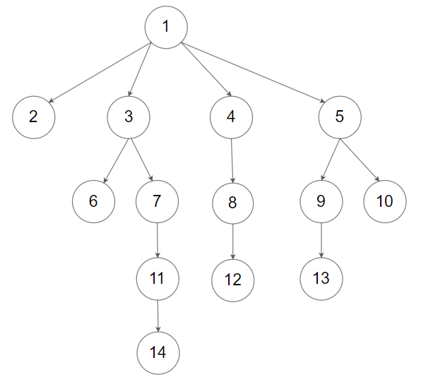

# [429. N-ary Tree Level Order Traversal](https://leetcode.com/problems/n-ary-tree-level-order-traversal/)

| Category | Difficulty | Likes | Dislikes |
| :------: | :--------: | :---: | :------: |
| Algorithms | Medium | 3732 | 144 |

**Tags:** [`tree`](https://leetcode.com/tag/tree), [`breadth-first-search`](https://leetcode.com/tag/breadth-first-search)

**Companies:** `amazon`, `google`, `microsoft`

## Description

Given an n-ary tree, return the *level order* traversal of its nodes' values.

*Nary-Tree input serialization is represented in their level order traversal, each group of children is separated by the null value (See examples).*

 

**Example 1:**


```

Input: root = [1,null,3,2,4,null,5,6]
Output: [[1],[3,2,4],[5,6]]

```

**Example 2:**



```

Input: root = [1,null,2,3,4,5,null,null,6,7,null,8,null,9,10,null,null,11,null,12,null,13,null,null,14]
Output: [[1],[2,3,4,5],[6,7,8,9,10],[11,12,13],[14]]

```

 

**Constraints:**

	- The height of the n-ary tree is less than or equal to `1000`

	- The total number of nodes is between `[0, 10^4]`

---

**Links:** [Submissions](https://leetcode.com/problems/n-ary-tree-level-order-traversal/) | [Solutions](https://leetcode.com/problems/n-ary-tree-level-order-traversal/)
