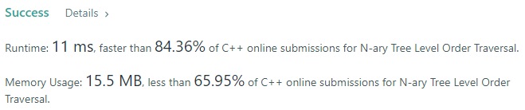
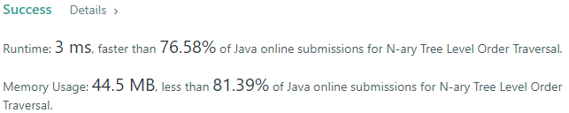
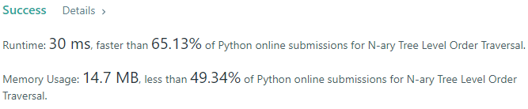
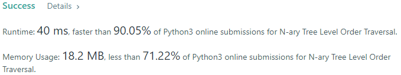
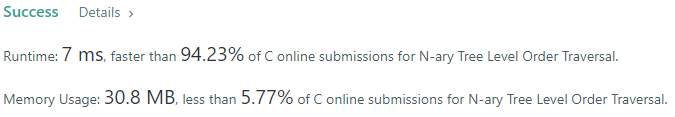
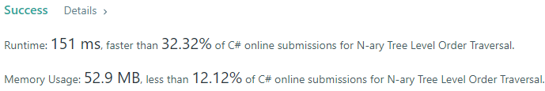
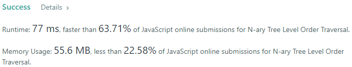

# 💢☠💫Easiest👾Faster✅💯 Lesser🧠 🎯 C++✅Python3🐍✅Java✅C✅Python🐍✅C#✅💥🔥💫Explained☠💥🔥 Beats 100

**Author:** Edwards310
**Votes:** 7
**Link:** [https://leetcode.com/problems/n-ary-tree-level-order-traversal/solutions/5693741/](https://leetcode.com/problems/n-ary-tree-level-order-traversal/solutions/5693741/)

---

# Intuition









---
1.***Q - 589***
https://leetcode.com/problems/n-ary-tree-preorder-traversal/solutions/5692438/easiestfaster-lesser-cpython3javacpythoncexplained-beats-100
2.***Q - 590***
https://leetcode.com/problems/n-ary-tree-postorder-traversal/solutions/5691837/easiest-faster-lesser-c-python3-java-c-python-c-explained-beats-100
---


```javascript []
//JavaScript Code
/**
 * // Definition for a _Node.
 * function _Node(val,children) {
 *    this.val = val;
 *    this.children = children;
 * };
 */

/**
 * @param {_Node|null} root
 * @return {number[][]}
 */
var levelOrder = function(root) {
    if(root == undefined)
        return []
    
    const arr = []
    const q = [root]
    while(q.length != 0){
        let n = q.length
        let temp = []
        for(let i = 0; i < n; i++){
            let node = q.shift()
            temp.push(node.val)
            for(let child of node.children)
                q.push(child)
        }
        arr.push(temp)
    }
    return arr
};
```
```C++ []
//C++ Code
/*
// Definition for a Node.
class Node {
public:
    int val;
    vector<Node*> children;

    Node() {}

    Node(int _val) {
        val = _val;
    }

    Node(int _val, vector<Node*> _children) {
        val = _val;
        children = _children;
    }
};
*/

class Solution {
public:
    vector<vector<int>> levelOrder(Node* root) {
        if(!root)
            return {};

        queue<Node*> q;
        vector<vector<int>> ans;
        q.push(root);

        while(!q.empty()){
            int n = q.size();
            vector<int> temp;

            for(int i = 0; i < n; i++){
                Node* child = q.front();
                q.pop();
                temp.push_back(child->val);

                for(auto node : child->children)
                    q.push(node);
            }
            ans.push_back(temp);
        }
        return ans;
    }
};
```
```Python3 []
#Python3 Code
"""
# Definition for a Node.
class Node:
    def __init__(self, val=None, children=None):
        self.val = val
        self.children = children
"""

class Solution:
    def levelOrder(self, root: 'Node') -> List[List[int]]:
        if not root:
            return []
        
        result = []
        queue = deque([root])
        
        while queue:
            level = []
            for _ in range(len(queue)):
                node = queue.popleft()
                level.append(node.val)
                for child in node.children:
                    queue.append(child)
            result.append(level)
        
        return result
```
```Java []
//Java Code
/*
// Definition for a Node.
class Node {
    public int val;
    public List<Node> children;

    public Node() {}

    public Node(int _val) {
        val = _val;
    }

    public Node(int _val, List<Node> _children) {
        val = _val;
        children = _children;
    }
};
*/

class Solution {
    public List<List<Integer>> levelOrder(Node root) {
        List<List<Integer>> ans = new ArrayList<>();
        if(root == null)
            return ans;
        
        Queue<Node> q = new LinkedList<>();
        q.add(root);
        while(!q.isEmpty()){
            int n = q.size();
            List<Integer> temp = new ArrayList<>();
            for(int i = 0; i < n; ++i){
                Node child = q.poll();
                temp.add(child.val);
                for(Node node : child.children)
                    q.add(node);
            }
            ans.add(temp);
        }
        return ans;
    }
}
```
```C []
//C Code
/**
 * Definition for a Node.
 * struct Node {
 *     int val;
 *     int numChildren;
 *     struct Node** children;
 * };
 */

/**
 * Return an array of arrays of size *returnSize.
 * The sizes of the arrays are returned as *returnColumnSizes array.
 * Note: Both returned array and *columnSizes array must be malloced, assume caller calls free().
 */

int maxDepth(struct Node* root) {
    if (!root) 
        return 0;
    
    if (root->numChildren == 0) 
        return 1;
    
    int max = 0;
    for (int i = 0; i < root->numChildren; i++) {
        int tmp = maxDepth(root->children[i]) + 1;
        max = tmp > max ? tmp : max;
    }
    return max;
}

void search(struct Node* root, int** arr, int ridx, int** returnColumnSizes) {
    if (!root) 
        return;
    
    arr[ridx][(*returnColumnSizes)[ridx]] = root->val;
    (*returnColumnSizes)[ridx]++;
    
    for (int i = 0; i < root->numChildren; i++) 
        search(root->children[i], arr, ridx+1, returnColumnSizes);
    
}

int** levelOrder(struct Node* root, int* returnSize, int** returnColumnSizes) {
    int depth = maxDepth(root);
    *returnSize = depth;
    *returnColumnSizes = (int*) calloc(depth, sizeof(int));
    int** arr = (int**) malloc(depth * sizeof(int*));
    for (int i = 0; i < depth; i++) {
        arr[i] = (int*) malloc(10000 * sizeof(int));
    }
    search(root, arr, 0, returnColumnSizes);
    return arr;
}
```
```Python []
#Python Code
"""
# Definition for a Node.
class Node(object):
    def __init__(self, val=None, children=None):
        self.val = val
        self.children = children
"""

class Solution(object):
    def levelOrder(self, root):
        """
        :type root: Node
        :rtype: List[List[int]]
        """
        q = deque([root])
        res = []
        
        if not root:
            return []
        
        while q:
            n = len(q)
            temp = []
            for i in range(n):
                node = q.popleft()
                temp.append(node.val)
                for child in node.children:
                    q.append(child)
            res.append(temp)
        
        return res
```
```C# []
//C# Code
/*
// Definition for a Node.
public class Node {
    public int val;
    public IList<Node> children;

    public Node() {}

    public Node(int _val) {
        val = _val;
    }

    public Node(int _val, IList<Node> _children) {
        val = _val;
        children = _children;
    }
}
*/

public class Solution {
    public IList<IList<int>> LevelOrder(Node root) {
        List<IList<int>> res = new List<IList<int>>();
        if(root == null)
            return res;
        
        Queue<Node> q = new Queue<Node>();
        q.Enqueue(root);
        
        while(q.Count() != 0){
            int n = q.Count();
            List<int> temp = new List<int>();
            for (int i = 0; i < n; ++i){
                Node node = q.Dequeue();
                temp.Add(node.val);
                foreach(Node child in node.children)
                    q.Enqueue(child);
            }
            res.Add(temp);
        }
        return res;
    }
}
```
<!-- Describe your first thoughts on how to solve this problem. -->

# Approach
<!-- Describe your approach to solving the problem. -->

# Complexity
- Time complexity:
<!-- Add your time complexity here, e.g. $$O(n)$$ -->
     O(N)
- Space complexity:
<!-- Add your space complexity here, e.g. $$O(n)$$ -->
     O(N)
# Code

