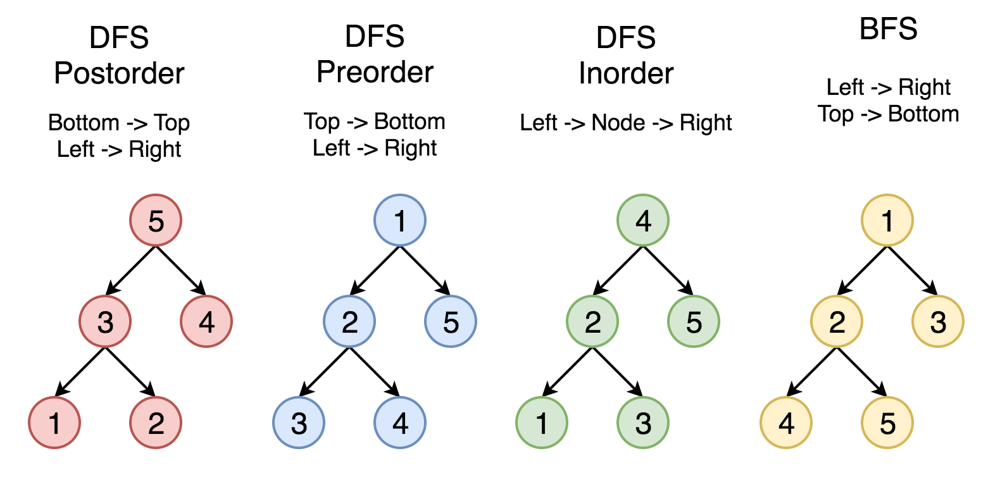
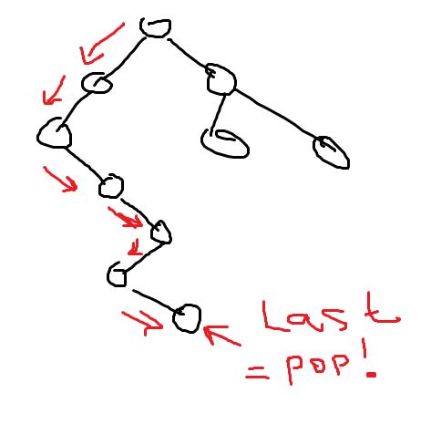
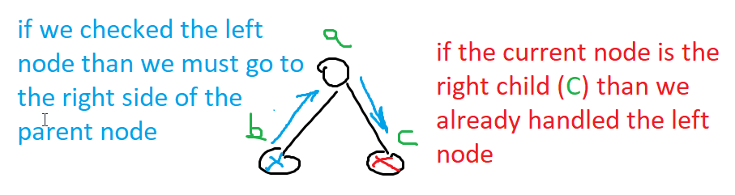

# Iterative post-order + prefix sum with explanation and pictures. Spent 2 days to learn post-order.

**Author:** Chuxel
**Votes:** 12
**Link:** [https://leetcode.com/problems/path-sum-iii/solutions/2205014/](https://leetcode.com/problems/path-sum-iii/solutions/2205014/)

---

To solve this problem we can combine two techniques: post-order tree traversal and prefix sum.


For post-order, at first we going to the left (or to the right if there is no left node) and bottom (until we find the leaf):


```
function postOrder(root: TreeNode): void {
  let curr = root;

  const stack = [];

  while (stack.length || curr) {
    // Going to the bottom
    while (curr) {
      stack.push(curr);

      if (curr.left) {
        curr = curr.left;
      } else if (curr.right) {
        curr = curr.right;
      } else {
        curr = null;
      }
    }

    // the last unhandled node
    const nPopped = stack.pop();
	calcTreeNode(nPopped);

    // if the current node is not left child of the latest node in stack
    // than it means we already checked the right side
	// in other words - if the current node is the left child than we must go right
    if (stack.length && stack[stack.length - 1].left == nPopped) {
      curr = stack[stack.length - 1].right;
    }
  }
}
```


Now, lets combine with prefix sum. While going to the bottom let's calculate our sum, count and count for the current sum. 
```
      currentSumm += curr.val;
      count += map.get(currentSumm - targetSum) ?? 0;
      map.set(currentSumm, (map.get(currentSumm) ?? 0) + 1);
```
Also, we must remember to backtrack the sum after we popped the node.
```
    map.set(currentSumm, map.get(currentSumm) - 1);
    currentSumm -= nPopped.val;
```

Full code:
```
function pathSum(root: TreeNode | null, targetSum: number): number {
  let curr = root;

  const stack = [];

  let currentSumm = 0;
  const map = new Map();
  map.set(0, 1);

  let count = 0;

  while (stack.length || curr) {
    // Going to the leftmost bottom
    while (curr) {
      stack.push(curr);

      //calculate summ, current count
      currentSumm += curr.val;

      count += map.get(currentSumm - targetSum) ?? 0;
      map.set(currentSumm, (map.get(currentSumm) ?? 0) + 1);

      if (curr.left) {
        curr = curr.left;
      } else if (curr.right) {
        curr = curr.right;
      } else {
        curr = null;
      }
    }

    const nPopped = stack.pop();

    // Revert summ operations
    map.set(currentSumm, map.get(currentSumm) - 1);
    currentSumm -= nPopped.val;
    //

    // if the current node is not left child of the latest node in stack
    // than it means we already checked the right side
    if (stack.length && stack[stack.length - 1].left == nPopped) {
      curr = stack[stack.length - 1].right;
    }
  }

  return count;
}
```
