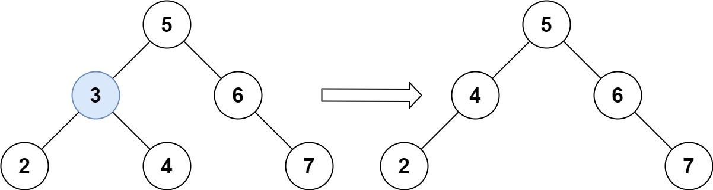

# [450. Delete Node in a BST](https://leetcode.com/problems/delete-node-in-a-bst/)

| Category | Difficulty | Likes | Dislikes |
| :------: | :--------: | :---: | :------: |
| Algorithms | Medium | 10197 | 380 |

**Tags:** [`tree`](https://leetcode.com/tag/tree), [`binary-search-tree`](https://leetcode.com/tag/binary-search-tree), [`binary-tree`](https://leetcode.com/tag/binary-tree)

**Companies:** `amazon`, `google`, `microsoft`, `oracle`, `bloomberg`, `linkedin`, `facebook`, `uber`, `flipkart`

## Description

Given a root node reference of a BST and a key, delete the node with the given key in the BST. Return *the **root node reference** (possibly updated) of the BST*.

Basically, the deletion can be divided into two stages:

	- Search for a node to remove.

	- If the node is found, delete the node.

 

**Example 1:**


```

Input: root = [5,3,6,2,4,null,7], key = 3
Output: [5,4,6,2,null,null,7]
Explanation: Given key to delete is 3. So we find the node with value 3 and delete it.
One valid answer is [5,4,6,2,null,null,7], shown in the above BST.
Please notice that another valid answer is [5,2,6,null,4,null,7] and it&#39;s also accepted.


```

**Example 2:**

```

Input: root = [5,3,6,2,4,null,7], key = 0
Output: [5,3,6,2,4,null,7]
Explanation: The tree does not contain a node with value = 0.

```

**Example 3:**

```

Input: root = [], key = 0
Output: []

```

 

**Constraints:**

	- The number of nodes in the tree is in the range `[0, 10^4]`.

	- `-10^5 <= Node.val <= 10^5`

	- Each node has a **unique** value.

	- `root` is a valid binary search tree.

	- `-10^5 <= key <= 10^5`

 

**Follow up:** Could you solve it with time complexity `O(height of tree)`?

---

**Links:** [Submissions](https://leetcode.com/problems/delete-node-in-a-bst/) | [Solutions](https://leetcode.com/problems/delete-node-in-a-bst/)
