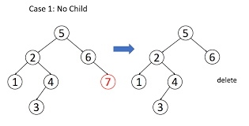
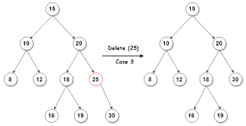
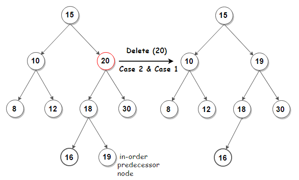

# ✔️[C++] Shortest Recursive Solution | Detailed Explanation with images

**Author:** Mythri_Kaulwar
**Votes:** 648
**Link:** [https://leetcode.com/problems/delete-node-in-a-bst/solutions/1590789/](https://leetcode.com/problems/delete-node-in-a-bst/solutions/1590789/)

---

**Firstly, thanks for refering to my solution in advance :)**
**Please UPVOTE\uD83D\uDD3C if you like it :)**

When we delete a node from a Binary Search Tree(BST), the BST properties should remain the same. 
Hence, we have 3 cases for deleting a node from a BST :
1.    ***The node is a leaf node*** - In this cases, we can just delete the node and return the root, since deleting any elaf node doesn't affect the remainig tree.


2.   ***The node has one child*** - In this case, replace the node with the child node and return the root.


3.   ***The node has 2 children*** - In this case, in order to conserve the BST properties, we need to replace the node with it's inorder successor (The next node that comes in the inorder traversal) i.e; we need to replace it with either :
                                 1. The greatest value node in it's left subtree (or)
                                 2. The smallest value node in it's right subtree
and return the root.



**Time Complexity :** O(h) - h = height of the tree.
(Worst case Time Complexity : O(n) )

**Code :**
```
class Solution {
public:
    TreeNode* deleteNode(TreeNode* root, int key) {
        if(root) 
            if(key < root->val) root->left = deleteNode(root->left, key);     //We frecursively call the function until we find the target node
            else if(key > root->val) root->right = deleteNode(root->right, key);       
            else{
                if(!root->left && !root->right) return NULL;          //No child condition
                if (!root->left || !root->right)
                    return root->left ? root->left : root->right;    //One child contion -> replace the node with it's child
					                                                //Two child condition   
                TreeNode* temp = root->left;                        //(or) TreeNode *temp = root->right;
                while(temp->right != NULL) temp = temp->right;     //      while(temp->left != NULL) temp = temp->left;
                root->val = temp->val;                            //       root->val = temp->val;
                root->left = deleteNode(root->left, temp->val);  //        root->right = deleteNode(root->right, temp);		
            }
        return root;
    }   
};
```

If you like my solution and explanation, **please UPVOTE!**