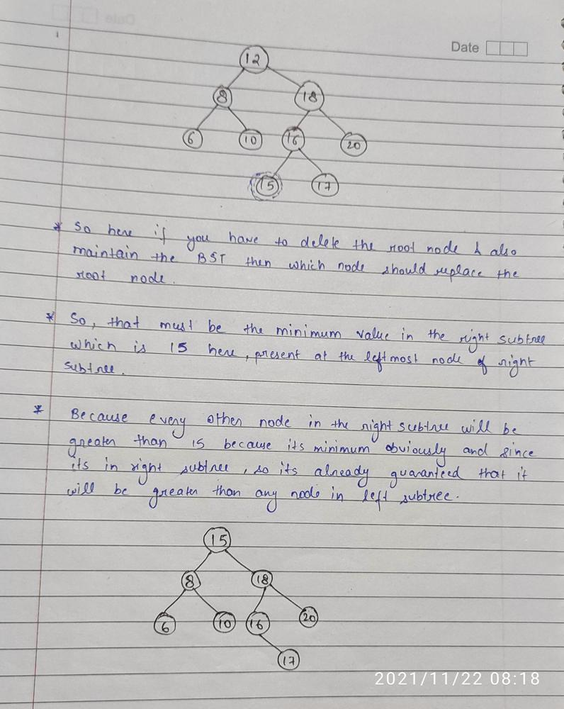

# ✔ JAVA | Recursive | Most Intutive | Proper Explanation Using Image

**Author:** Chaitanya1706
**Votes:** 121
**Link:** [https://leetcode.com/problems/delete-node-in-a-bst/solutions/1590868/](https://leetcode.com/problems/delete-node-in-a-bst/solutions/1590868/)

---

**Intution:** Use the BST property to search the node and then delete if found the required node.

* So if the traget node has value less than root then we will surely get it in the left subtree...so just call ur recursive function for the left subtree.
* If the traget node has value greater than root then we will surely get it in the right subtree...so just call ur recursive function for the right subtree.
* And now comes the case when u have to do your work that is root itself is the required node to be deleted. Here again comes three cases:
	1. 	If left of root is null and u also have to delete the root node...then just simply return the right subtree.
	2. 	If right of root is null and u also have to delete the root node...then just simply return the left subtree.
	3. 	Both are not null then you have to not just delete the node but also maintain the BST structure.
So now you have to think if you delete the root node then which node can optimally replace it so that all the nodes on left are still small and on right are larger.
**So that node will be the node just greater than the largest node in the left subtree which is the smallest node in the right subtree**


		* So point your pointer on the right subtree and then move it to the left most node of this subtree that will be your required node and so now replace the value of your root with this node value which will ensure that the key which u wanted to delete is deleted and the value there is  the right value.
		* Now you have to delete that node whose value is already present in the root...so now that work will be done by the recursion so now just pass that right subtree in which the value is present with that nodes value which will be now the target
```
class Solution {
    public TreeNode deleteNode(TreeNode root, int key) {
        if(root==null) return null;
        
        if(key<root.val){                            
            root.left = deleteNode(root.left,key);
            return root;
        }
        
        else if(key>root.val){
            root.right = deleteNode(root.right,key);
            return root;
        }
        
        else{
            if(root.left==null){
                return root.right;
            }
            else if(root.right==null){
                return root.left;
            }
            else{
                TreeNode min = root.right;
                while(min.left!=null){
                    min = min.left;
                }
                
                root.val = min.val;
                root.right = deleteNode(root.right,min.val);
                return root;
            }
        }
    }
}