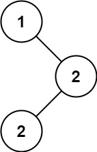

# [501. Find Mode in Binary Search Tree](https://leetcode.com/problems/find-mode-in-binary-search-tree/)

| Category | Difficulty | Likes | Dislikes |
| :------: | :--------: | :---: | :------: |
| Algorithms | Easy | 4080 | 811 |

**Tags:** [`tree`](https://leetcode.com/tag/tree), [`depth-first-search`](https://leetcode.com/tag/depth-first-search), [`binary-search-tree`](https://leetcode.com/tag/binary-search-tree), [`binary-tree`](https://leetcode.com/tag/binary-tree)

**Companies:** `amazon`, `google`, `facebook`

## Description

Given the `root` of a binary search tree (BST) with duplicates, return *all the mode(s) (i.e., the most frequently occurred element) in it*.

If the tree has more than one mode, return them in **any order**.

Assume a BST is defined as follows:

	- The left subtree of a node contains only nodes with keys **less than or equal to** the node's key.

	- The right subtree of a node contains only nodes with keys **greater than or equal to** the node's key.

	- Both the left and right subtrees must also be binary search trees.

 

**Example 1:**


```

Input: root = [1,null,2,2]
Output: [2]

```

**Example 2:**

```

Input: root = [0]
Output: [0]

```

 

**Constraints:**

	- The number of nodes in the tree is in the range `[1, 10^4]`.

	- `-10^5 <= Node.val <= 10^5`

 

**Follow up:** Could you do that without using any extra space? (Assume that the implicit stack space incurred due to recursion does not count).

---

**Links:** [Submissions](https://leetcode.com/problems/find-mode-in-binary-search-tree/) | [Solutions](https://leetcode.com/problems/find-mode-in-binary-search-tree/)
