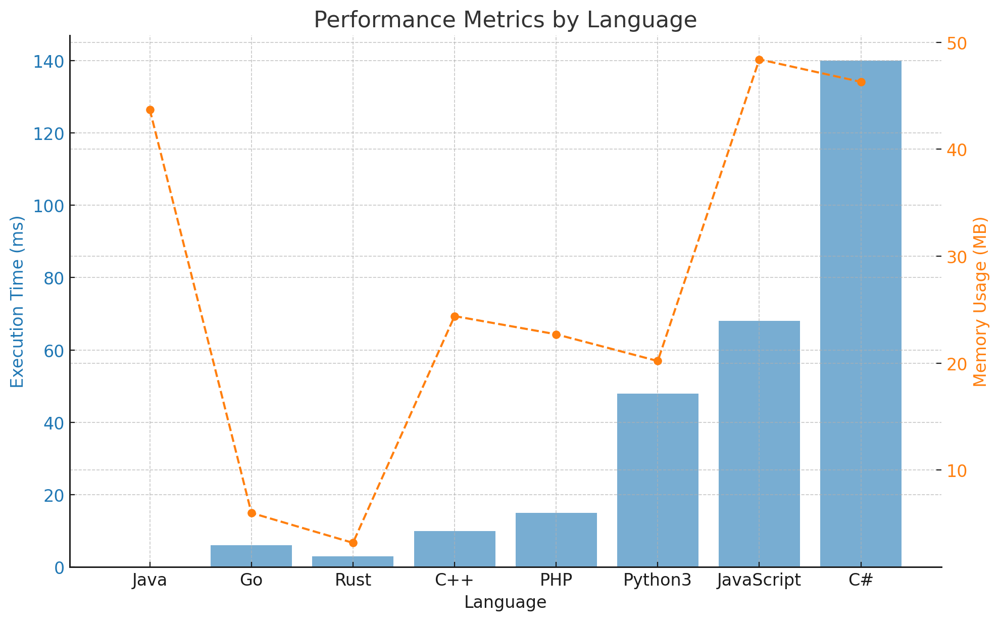

# ✅ 99.54% In-order Traversal Generator

**Author:** vanAmsen
**Votes:** 61
**Link:** [https://leetcode.com/problems/find-mode-in-binary-search-tree/solutions/4232836/](https://leetcode.com/problems/find-mode-in-binary-search-tree/solutions/4232836/)

---

# Intuition
When we are given a Binary Search Tree (BST) and asked about frequency or mode, the first thing that should come to mind is in-order traversal. This is because an in-order traversal of a BST gives a sorted sequence of its values. If we traverse the BST in-order, then same values will appear consecutively in the sequence. This makes it easy to count the occurrences of each value and determine the mode.

# Live Coding + Logic
https://youtu.be/h-3X7bUQsbo?si=nBLyZXQREsQUEaRe

# Approach
1. **In-order Traversal Generator**: We'll use an in-order traversal to traverse through the BST. Instead of doing the counting inside the recursive traversal, we use a generator to yield the values in-order.
2. **Counting and Finding Modes**: As we iterate through the values returned from the in-order traversal, we keep track of the current number and its count. We compare it with the previous value:
   - If it's the same, we increment the count.
   - If it's different, we reset the count to 1 and update the current number.
   
   As we iterate, we keep track of the maximum count. If the count of a number equals the maximum count, we add it to the modes list. If it's greater than the maximum count, we reset the modes list and add the current number.

# Complexity
- **Time complexity**: $O(n)$. Each node is visited once in the in-order traversal, making the time complexity linear with respect to the number of nodes.
- **Space complexity**: $O(n)$ in the worst case when storing the modes. However, if we exclude the space required for the output, the space complexity is $O(h)$, where $h$ is the height of the tree, because of the recursive stack. For a balanced BST, $h = \\log n$, but in the worst case (a skewed tree), $h = n$.

# Code
``` Python []
class Solution:
    def findMode(self, root: Optional[TreeNode]) -> List[int]:
        def in_order_traversal(node):
            nonlocal current_val, current_count, max_count, modes
            if not node:
                return
            
            in_order_traversal(node.left)
            
            current_count = current_count + 1 if node.val == current_val else 1
            current_val = node.val
            
            if current_count > max_count:
                max_count = current_count
                modes = [current_val]
            elif current_count == max_count:
                modes.append(current_val)
            
            in_order_traversal(node.right)
            
        current_val = None
        current_count = 0
        max_count = 0
        modes = []
        in_order_traversal(root)
        return modes
```
``` Go []
func findMode(root *TreeNode) []int {
    var currentVal, currentCount, maxCount int
    var modes []int

    inOrderTraversal(root, &currentVal, &currentCount, &maxCount, &modes)

    return modes
}

func inOrderTraversal(node *TreeNode, currentVal, currentCount, maxCount *int, modes *[]int) {
    if node == nil {
        return
    }

    inOrderTraversal(node.Left, currentVal, currentCount, maxCount, modes)

    if node.Val == *currentVal {
        *currentCount++
    } else {
        *currentVal = node.Val
        *currentCount = 1
    }

    if *currentCount == *maxCount {
        *modes = append(*modes, *currentVal)
    } else if *currentCount > *maxCount {
        *maxCount = *currentCount
        *modes = []int{*currentVal}
    }

    inOrderTraversal(node.Right, currentVal, currentCount, maxCount, modes)
}
```
``` Rust []
use std::rc::Rc;
use std::cell::RefCell;

impl Solution {
    pub fn find_mode(root: Option<Rc<RefCell<TreeNode>>>) -> Vec<i32> {
        let mut current_val = 0;
        let mut current_count = 0;
        let mut max_count = 0;
        let mut modes = Vec::new();

        Self::in_order_traversal(&root, &mut current_val, &mut current_count, &mut max_count, &mut modes);

        modes
    }
    
    fn in_order_traversal(node: &Option<Rc<RefCell<TreeNode>>>, current_val: &mut i32, current_count: &mut i32, max_count: &mut i32, modes: &mut Vec<i32>) {
        if let Some(n) = node {
            let n = n.borrow();

            Self::in_order_traversal(&n.left, current_val, current_count, max_count, modes);

            *current_count = if n.val == *current_val { *current_count + 1 } else { 1 };
            *current_val = n.val;

            if *current_count == *max_count {
                modes.push(*current_val);
            } else if *current_count > *max_count {
                *max_count = *current_count;
                *modes = vec![*current_val];
            }

            Self::in_order_traversal(&n.right, current_val, current_count, max_count, modes);
        }
    }
}
```
``` C++ []
class Solution {
public:
    std::vector<int> findMode(TreeNode* root) {
        in_order_traversal(root);
        return modes;
    }
private:
    int current_val = 0;
    int current_count = 0;
    int max_count = 0;
    std::vector<int> modes;

    void in_order_traversal(TreeNode* node) {
        if (!node) return;
        
        in_order_traversal(node->left);
        
        current_count = (node->val == current_val) ? current_count + 1 : 1;
        if (current_count == max_count) {
            modes.push_back(node->val);
        } else if (current_count > max_count) {
            max_count = current_count;
            modes = { node->val };
        }
        current_val = node->val;

        in_order_traversal(node->right);
    }
};
```
``` Java []
class Solution {
    private int currentVal;
    private int currentCount = 0;
    private int maxCount = 0;
    private List<Integer> modes = new ArrayList<>();

    public int[] findMode(TreeNode root) {
        inOrderTraversal(root);
        int[] result = new int[modes.size()];
        for (int i = 0; i < modes.size(); i++) {
            result[i] = modes.get(i);
        }
        return result;
    }

    private void inOrderTraversal(TreeNode node) {
        if (node == null) return;

        inOrderTraversal(node.left);

        currentCount = (node.val == currentVal) ? currentCount + 1 : 1;
        if (currentCount == maxCount) {
            modes.add(node.val);
        } else if (currentCount > maxCount) {
            maxCount = currentCount;
            modes.clear();
            modes.add(node.val);
        }
        currentVal = node.val;

        inOrderTraversal(node.right);
    }
}
```
``` C# []
public class Solution {
    private int? current_val = null;
    private int current_count = 0;
    private int max_count = 0;
    private List<int> modes = new List<int>();

    public int[] FindMode(TreeNode root) {
        in_order_traversal(root);
        return modes.ToArray();
    }

    private void in_order_traversal(TreeNode node) {
        if (node == null) return;

        in_order_traversal(node.left);

        current_count = (node.val == current_val) ? current_count + 1 : 1;
        if (current_count == max_count) {
            modes.Add(node.val);
        } else if (current_count > max_count) {
            max_count = current_count;
            modes.Clear();
            modes.Add(node.val);
        }
        current_val = node.val;

        in_order_traversal(node.right);
    }
}
```
``` JavaScript []

var findMode = function(root) {
    let currentVal = null;
    let currentCount = 0;
    let maxCount = 0;
    let modes = [];

    function inOrderTraversal(node) {
        if (!node) return;

        inOrderTraversal(node.left);

        currentCount = (node.val === currentVal) ? currentCount + 1 : 1;
        if (currentCount === maxCount) {
            modes.push(node.val);
        } else if (currentCount > maxCount) {
            maxCount = currentCount;
            modes = [node.val];
        }
        currentVal = node.val;

        inOrderTraversal(node.right);
    }

    inOrderTraversal(root);
    return modes;
};
```
``` PHP []

class Solution {
    private $currentVal;
    private $currentCount = 0;
    private $maxCount = 0;
    private $modes = [];

    /**
     * @param TreeNode $root
     * @return Integer[]
     */
    function findMode($root) {
        $this->inOrderTraversal($root);
        return $this->modes;
    }

    private function inOrderTraversal($node) {
        if ($node === null) return;

        $this->inOrderTraversal($node->left);

        $this->currentCount = ($node->val == $this->currentVal) ? $this->currentCount + 1 : 1;
        if ($this->currentCount == $this->maxCount) {
            $this->modes[] = $node->val;
        } else if ($this->currentCount > $this->maxCount) {
            $this->maxCount = $this->currentCount;
            $this->modes = [$node->val];
        }
        $this->currentVal = $node->val;

        $this->inOrderTraversal($node->right);
    }
}
```

# Performance

| Language   | Execution Time (ms) | Memory Usage (MB) |
|------------|---------------------|-------------------|
| Java       | 0                   | 43.7              |
| Go         | 6                   | 6.0               |
| Rust       | 3                   | 3.2               |
| C++        | 10                  | 24.4              |
| PHP        | 15                  | 22.7              |
| Python3    | 48                  | 20.2              |
| JavaScript | 68                  | 48.4              |
| C#         | 140                 | 46.3              |




# What did we learn?
- The importance of in-order traversal in a BST when dealing with frequency or order-related questions.
- How to effectively use Python's generator to make the code more Pythonic and readable.
- The approach to count and find the mode by processing the nodes during the in-order traversal.