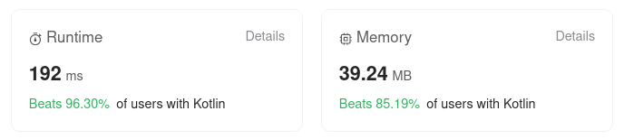

# Kotlin. Beats 96% of users (without using hashmap at the end)

**Author:** mobdev778
**Votes:** 1
**Link:** [https://leetcode.com/problems/find-mode-in-binary-search-tree/solutions/4234284/](https://leetcode.com/problems/find-mode-in-binary-search-tree/solutions/4234284/)

---




# Code
```
class Solution {

    fun findMode(root: TreeNode?): IntArray {
        max = 0
        valueFreqMap.clear()
        result.clear()
        calcF(root!!)
        return result.toIntArray()
    }

    private fun calcF(node: TreeNode) {
        val value = node.`val`
        val newFreq = valueFreqMap.getOrDefault(value, 0) + 1
        valueFreqMap[value] = newFreq
        when {
            newFreq > max -> {
                max = newFreq
                if (result.size != 1 || result[0] != value) {
                    result.clear()
                    result.add(value)
                }
            }
            newFreq == max -> {
                result.add(value)
            }
        }

        val left = node.left
        val right = node.right
        when {
            left != null && right != null -> when {
                right.`val` == value -> {
                    calcF(right)
                    calcF(left)
                }
                else -> {
                    calcF(left)
                    calcF(right)
                }
            }
            right != null -> calcF(right)
            left != null -> calcF(left)
            else -> { /* no op */}
        }
    }

    companion object {
        var max = 0
        val valueFreqMap = HashMap<Int, Int>()
        val result = ArrayList<Int>()
    }
}
```

# Intuition
We need to go through all the elements of the tree and calculate the frequencies using a hash map.

# Approach
The first option I wrote was one with frequency counting and subsequent iteration through a hash map. But then I found out that the resulting list can be compiled as you move inside the tree - it is easy to do if you know the last maximum frequency.

The second important point in optimization is the choice of the next subbranch. If we prefer a subbranch with the same values as the level above, we will accumulate the maximum value faster and we will have to reset the resulting list less often.

Speed measurements showed that each additional parameter in the recursion increases the execution time of the program, so I moved the common variables into "companion object" area.


