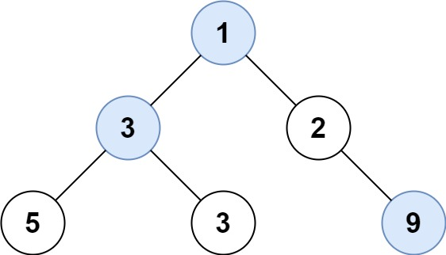

# [515. Find Largest Value in Each Tree Row](https://leetcode.com/problems/find-largest-value-in-each-tree-row/)

| Category | Difficulty | Likes | Dislikes |
| :------: | :--------: | :---: | :------: |
| Algorithms | Medium | 4105 | 129 |

**Tags:** [`tree`](https://leetcode.com/tag/tree), [`depth-first-search`](https://leetcode.com/tag/depth-first-search), [`breadth-first-search`](https://leetcode.com/tag/breadth-first-search), [`binary-tree`](https://leetcode.com/tag/binary-tree)

**Companies:** `josh-technology`, `facebook`, `google`, `microsoft`, `amazon`, `bloomberg`, `linkedin`

## Description

Given the `root` of a binary tree, return *an array of the largest value in each row* of the tree **(0-indexed)**.

 

**Example 1:**


```

Input: root = [1,3,2,5,3,null,9]
Output: [1,3,9]

```

**Example 2:**

```

Input: root = [1,2,3]
Output: [1,3]

```

 

**Constraints:**

	- The number of nodes in the tree will be in the range `[0, 10^4]`.

	- `-2^31 <= Node.val <= 2^31 - 1`

---

**Links:** [Submissions](https://leetcode.com/problems/find-largest-value-in-each-tree-row/) | [Solutions](https://leetcode.com/problems/find-largest-value-in-each-tree-row/)
