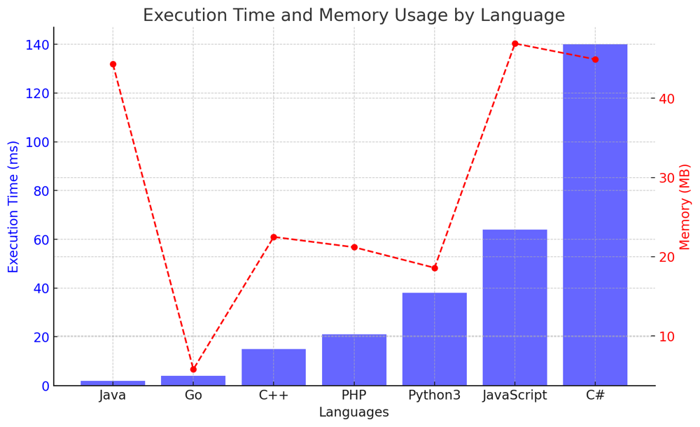

# ✅ 98.68% BFS

**Author:** vanAmsen
**Votes:** 52
**Link:** [https://leetcode.com/problems/find-largest-value-in-each-tree-row/solutions/4201233/](https://leetcode.com/problems/find-largest-value-in-each-tree-row/solutions/4201233/)

---

# Intuition
When presented with this problem, the immediate thought is to traverse through the tree level by level. This is because we need to determine the maximum value in each row. Level order traversal, also known as breadth-first search (BFS) for trees, is the ideal strategy for this. Using a queue, we can explore each level of the tree one by one and capture the maximum value for each.

# Live Coding + Comments
https://youtu.be/G4_vIA1eGA8?si=UBrPO5km7rbyQ5yJ

# Approach
1. **Initialization**: Begin with initializing a queue and adding the root node to it. This queue will help in level order traversal.
2. **Level-wise Traversal**: As long as the queue is not empty, we keep on processing nodes. For each level, we will calculate its size (i.e., the number of nodes in the current level). This helps in segregating nodes of different levels.
3. **Capture Maximum**: For each level, initialize a variable `max_val` with the smallest possible integer. As we process each node in the current level, we update `max_val` to be the maximum between the node's value and the current `max_val`.
4. **Child Processing**: After processing a node, we add its left and right children (if they exist) to the queue for the next level's processing.
5. **Result Update**: Once all nodes of a level are processed, the maximum value for that level (`max_val`) is added to the result list.

# Complexity
- **Time complexity**: $O(n)$. Each node is processed once, and the maximum value at each level is determined in constant time. So, the overall time taken is linear with respect to the number of nodes.
  
- **Space complexity**: $O(n)$. In the worst case, the queue can hold all leaf nodes. In a balanced binary tree, the last level can have $n/2$ nodes. Thus, the space complexity is linear.

# Code
``` Python []
class Solution:
    def largestValues(self, root: Optional[TreeNode]) -> List[int]:
        if not root:
            return []
        
        result = []
        queue = deque([root])
        
        while queue:
            curr_level_size = len(queue)
            max_val = float('-inf')
            
            for _ in range(curr_level_size):
                node = queue.popleft()
                max_val = max(max_val, node.val)
                
                for child in [node.left, node.right]:
                    if child:
                        queue.append(child)
            
            result.append(max_val)
        
        return result
```
``` C++ []
class Solution {
public:
    std::vector<int> largestValues(TreeNode* root) {
        if (!root) return {};
        
        std::vector<int> result;
        std::queue<TreeNode*> queue;
        queue.push(root);
        
        while (!queue.empty()) {
            int curr_level_size = queue.size();
            int max_val = INT_MIN;
            
            for (int i = 0; i < curr_level_size; ++i) {
                TreeNode* node = queue.front();
                queue.pop();
                max_val = std::max(max_val, node->val);
                
                if (node->left) queue.push(node->left);
                if (node->right) queue.push(node->right);
            }
            
            result.push_back(max_val);
        }
        
        return result;
    }
};
```
``` Java []
public class Solution {
    public List<Integer> largestValues(TreeNode root) {
        if (root == null) return new ArrayList<>();
        
        List<Integer> result = new ArrayList<>();
        Queue<TreeNode> queue = new LinkedList<>();
        queue.offer(root);
        
        while (!queue.isEmpty()) {
            int curr_level_size = queue.size();
            int max_val = Integer.MIN_VALUE;
            
            for (int i = 0; i < curr_level_size; i++) {
                TreeNode node = queue.poll();
                max_val = Math.max(max_val, node.val);
                
                if (node.left != null) queue.offer(node.left);
                if (node.right != null) queue.offer(node.right);
            }
            
            result.add(max_val);
        }
        
        return result;
    }
}
```
``` Go []
func largestValues(root *TreeNode) []int {
    if root == nil {
        return nil
    }
    
    var result []int
    queue := []*TreeNode{root}
    
    for len(queue) > 0 {
        curr_level_size := len(queue)
        max_val := ^(int(^uint(0) >> 1))  // Integer minimum
        
        for i := 0; i < curr_level_size; i++ {
            node := queue[0]
            queue = queue[1:]
            if node.Val > max_val {
                max_val = node.Val
            }
            
            if node.Left != nil {
                queue = append(queue, node.Left)
            }
            if node.Right != nil {
                queue = append(queue, node.Right)
            }
        }
        
        result = append(result, max_val)
    }
    
    return result
}
```
``` JavaScript []
function largestValues(root) {
    if (!root) return [];
    
    const result = [];
    const queue = [root];
    
    while (queue.length) {
        let curr_level_size = queue.length;
        let max_val = Number.MIN_SAFE_INTEGER;
        
        for (let i = 0; i < curr_level_size; i++) {
            const node = queue.shift();
            max_val = Math.max(max_val, node.val);
            
            if (node.left) queue.push(node.left);
            if (node.right) queue.push(node.right);
        }
        
        result.push(max_val);
    }
    
    return result;
}
```
``` C# []
public class Solution {
    public IList<int> LargestValues(TreeNode root) {
        if (root == null) return new List<int>();
        
        List<int> result = new List<int>();
        Queue<TreeNode> queue = new Queue<TreeNode>();
        queue.Enqueue(root);
        
        while (queue.Count > 0) {
            int curr_level_size = queue.Count;
            int max_val = Int32.MinValue;
            
            for (int i = 0; i < curr_level_size; i++) {
                TreeNode node = queue.Dequeue();
                max_val = Math.Max(max_val, node.val);
                
                if (node.left != null) queue.Enqueue(node.left);
                if (node.right != null) queue.Enqueue(node.right);
            }
            
            result.Add(max_val);
        }
        
        return result;
    }
}
```
``` PHP []
class Solution {
    function largestValues($root) {
        if (!$root) return [];
        
        $result = [];
        $queue = [$root];
        
        while (count($queue)) {
            $curr_level_size = count($queue);
            $max_val = PHP_INT_MIN;
            
            for ($i = 0; $i < $curr_level_size; $i++) {
                $node = array_shift($queue);
                $max_val = max($max_val, $node->val);
                
                if ($node->left) array_push($queue, $node->left);
                if ($node->right) array_push($queue, $node->right);
            }
            
            $result[] = $max_val;
        }
        
        return $result;
    }
}
```

## Performance
| Language   | Execution Time (ms) | Memory (MB) |
|------------|---------------------|-------------|
| Java       | 2 ms                | 44.3 MB     |
| Go         | 4 ms                | 5.8 MB      |
| C++        | 15 ms               | 22.5 MB     |
| PHP        | 21 ms               | 21.2 MB     |
| Python3    | 38 ms               | 18.6 MB     |
| JavaScript | 64 ms               | 46.9 MB     |
| C#         | 140 ms              | 44.9 MB     |




# What have we learned?
From this problem, we have reinforced the concept of level order traversal in trees. We also learned the importance of using a queue for BFS to traverse each level sequentially. By processing each level separately, we could easily compute the maximum value for each row. This problem is a good demonstration of how tree traversal techniques can be tailored to extract specific details from each level of a tree.

# Why does it work?
This approach works because BFS ensures that all nodes at a particular depth (or level) are processed before moving on to nodes at the next depth. This ordering allows us to easily segregate nodes of different levels and compute the maximum value for each level separately.