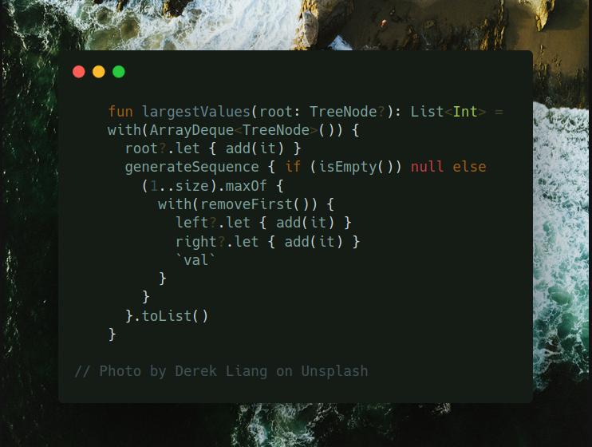

# Kotlin | bfs

**Author:** SamoylenkoDmitry
**Votes:** 2
**Link:** [https://leetcode.com/problems/find-largest-value-in-each-tree-row/solutions/4201719/](https://leetcode.com/problems/find-largest-value-in-each-tree-row/solutions/4201719/)

---



#### Join me on Telegram

https://t.me/leetcode_daily_unstoppable/380

#### Problem TLDR

Binary Tree's maxs of the levels

#### Intuition

Just use Breadth-First Search

#### Approach

Let's use some Kotlin's API:
* generateSequence
* maxOf

#### Complexity

- Time complexity:
$$O(n)$$

- Space complexity:
$$O(n)$$

#### Code

```kotlin

    fun largestValues(root: TreeNode?): List<Int> = 
    with(ArrayDeque<TreeNode>()) {
      root?.let { add(it) }
      generateSequence { if (isEmpty()) null else 
        (1..size).maxOf {
          with(removeFirst()) {
            left?.let { add(it) }
            right?.let { add(it) }
            `val`
          }
        }
      }.toList()
    }

```