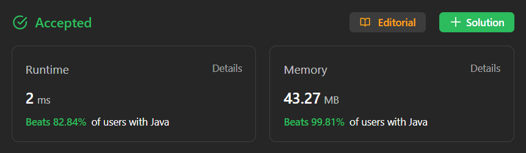

# ✅ Much Easier ✅ BFS ✅Video Explanation✅ Simple Approach ✅ Beats 100% ✅ Easy To Understand

**Author:** millenium103
**Votes:** 15
**Link:** [https://leetcode.com/problems/find-largest-value-in-each-tree-row/solutions/4201695/](https://leetcode.com/problems/find-largest-value-in-each-tree-row/solutions/4201695/)

---



 YouTube Video Explanation
[https://youtu.be/BhedpIUwO18](https://youtu.be/BhedpIUwO18)

\uD83D\uDD25 ***Please like, share, and subscribe to support our channel's mission of making complex concepts easy to understand.***

Subscribe Link: https://www.youtube.com/@leetlogics/?sub_confirmation=1

***Subscribe Goal: 150 Subscribers
Current Subscribers: 120***


# Intuition:

This problem essentially requires a level-order traversal of the binary tree while keeping track of the maximum value in each level. We can use a breadth-first search (BFS) approach for this. Starting from the root, we enqueue each level's nodes and keep track of the maximum value in that level.

# Approach:

1. We can use a BFS traversal with a queue to process each level. 
2. Start by enqueuing the root node.
3. While the queue is not empty, process the nodes of the current level:
   a. For each node in the current level, update the maximum value seen so far.
   b. If the node has left and right children, enqueue them.
4. After processing all nodes in a level, add the maximum value to the result list.
5. Continue this process until the queue is empty, which means all levels are processed.


# Complexity Analysis:

- Time Complexity: We visit each node exactly once, so the time complexity is O(N), where N is the number of nodes in the binary tree.
- Space Complexity: In the worst case, the queue can contain all the nodes of a level, which is O(N).

# Code
## Java
```
class Solution {
    public List<Integer> largestValues(TreeNode root) {
        Queue<TreeNode> queue = new LinkedList<>();
        List<Integer> ans = new ArrayList<>();
        queue.offer(root);
        if(root==null)  return ans;
        while(!queue.isEmpty())
        {
            int level = queue.size();
            int max = Integer.MIN_VALUE;
            for(int i=0;i<level;i++)
            {
                TreeNode temp =queue.poll();
                if(temp.left!=null)
                {
                    queue.offer(temp.left);
                }
                if(temp.right!=null)
                {
                    queue.offer(temp.right);
                }
                max= Math.max(max, temp.val);
            }
            ans.add(max);
        }
        return ans;
    }
}
```
## C++
```
class Solution {
public:
    vector<int> largestValues(TreeNode* root) {
        queue<TreeNode*> queue;
        vector<int> ans;
        queue.push(root);
        if (!root) return ans;
        while (!queue.empty()) {
            int level = queue.size();
            int max_val = INT_MIN;
            for (int i = 0; i < level; i++) {
                TreeNode* temp = queue.front();
                queue.pop();
                if (temp->left) {
                    queue.push(temp->left);
                }
                if (temp->right) {
                    queue.push(temp->right);
                }
                max_val = max(max_val, temp->val);
            }
            ans.push_back(max_val);
        }
        return ans;
    }
};
```

## Python
```
class Solution(object):
    def largestValues(self, root):
        queue = deque()
        ans = []
        queue.append(root)
        if not root:
            return ans
        while queue:
            level = len(queue)
            max_val = float('-inf')
            for i in range(level):
                temp = queue.popleft()
                if temp.left:
                    queue.append(temp.left)
                if temp.right:
                    queue.append(temp.right)
                max_val = max(max_val, temp.val)
            ans.append(max_val)
        return ans
```
## Javascript
```
var largestValues = function(root) {
    const queue = [];
        const ans = [];
        queue.push(root);
        if (!root) return ans;
        while (queue.length > 0) {
            const level = queue.length;
            let maxVal = -Infinity;
            for (let i = 0; i < level; i++) {
                const temp = queue.shift();
                if (temp.left) {
                    queue.push(temp.left);
                }
                if (temp.right) {
                    queue.push(temp.right);
                }
                maxVal = Math.max(maxVal, temp.val);
            }
            ans.push(maxVal);
        }
        return ans;
};
```
---


