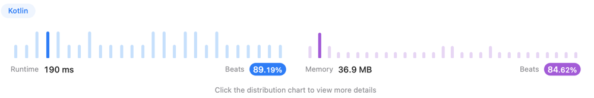

# .::Kotlin::. In-order traversal - O(n) - Explained

**Author:** dzmtr
**Votes:** 3
**Link:** [https://leetcode.com/problems/minimum-absolute-difference-in-bst/solutions/3636804/](https://leetcode.com/problems/minimum-absolute-difference-in-bst/solutions/3636804/)

---

\uD83D\uDCA1 Doing in-order traversal (`left` -> `val` -> `right`) we will get the list of sorted values.

The min difference is between closest values and max diff - between furthest. And we even don't need to alllocate the whole list of values, just compere current with previous.

```
Time: O(n), Space: O(H), where H - height of BST.
```

```
import kotlin.math.*

class Solution {
    fun getMinimumDifference(root: TreeNode?): Int {
        var prev : TreeNode? = null
        var diff = Int.MAX_VALUE

        fun dfs(node: TreeNode?) {
            if (node == null) return
            dfs(node.left)
            if (prev != null) { diff = minOf(abs(prev!!.`val` - node.`val`), diff) }
            prev = node
            dfs(node.right)
        }

        dfs(root)
        
        return diff
    }
}
```


