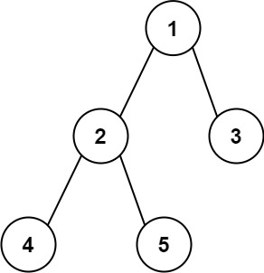

# [543. Diameter of Binary Tree](https://leetcode.com/problems/diameter-of-binary-tree/)

| Category | Difficulty | Likes | Dislikes |
| :------: | :--------: | :---: | :------: |
| Algorithms | Easy | 15326 | 1212 |

**Tags:** [`tree`](https://leetcode.com/tag/tree), [`depth-first-search`](https://leetcode.com/tag/depth-first-search), [`binary-tree`](https://leetcode.com/tag/binary-tree)

**Companies:** `facebook`, `amazon`, `microsoft`, `oracle`, `google`, `bloomberg`, `verkada`, `tiktok`, `apple`, `adobe`, `visa`, `linkedin`, `tcs`, `wix`

## Description

Given the `root` of a binary tree, return *the length of the **diameter** of the tree*.

The **diameter** of a binary tree is the **length** of the longest path between any two nodes in a tree. This path may or may not pass through the `root`.

The **length** of a path between two nodes is represented by the number of edges between them.

 

**Example 1:**


```

Input: root = [1,2,3,4,5]
Output: 3
Explanation: 3 is the length of the path [4,2,1,3] or [5,2,1,3].

```

**Example 2:**

```

Input: root = [1,2]
Output: 1

```

 

**Constraints:**

	- The number of nodes in the tree is in the range `[1, 10^4]`.

	- `-100 <= Node.val <= 100`

---

**Links:** [Submissions](https://leetcode.com/problems/diameter-of-binary-tree/) | [Solutions](https://leetcode.com/problems/diameter-of-binary-tree/)
