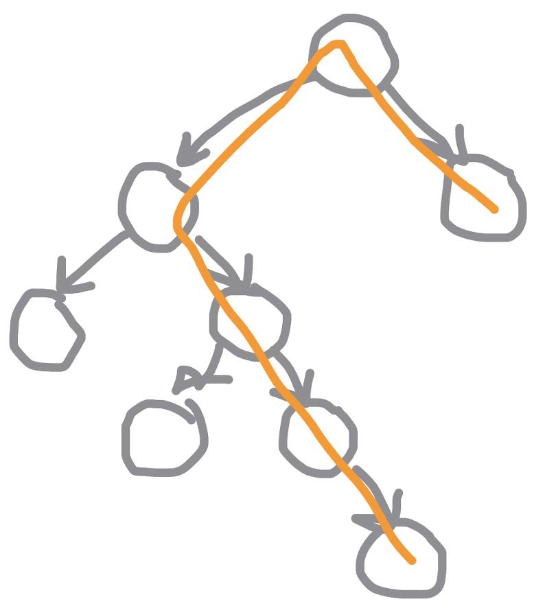

# C# | 97% Faster | Recursion | Clear Explanation

**Author:** nghihua
**Votes:** 6
**Link:** [https://leetcode.com/problems/diameter-of-binary-tree/solutions/3141387/](https://leetcode.com/problems/diameter-of-binary-tree/solutions/3141387/)

---

# Intuition
Bottom-up approach.



Take a look at this tree. The diameter is the orange path. 

**Observation 1:** Every path that is a possible diameter must have three components: left path, right path, and a connecting node between left path and right path. In our case, left path has 4 nodes, right path has 1 node, and the connecting node is the tree root.

**Observation 2:** The left path is the longest path on the left. Same for the right path.

# Approach

Thus, to find the diameter of the tree, we repeatedly do these steps:
- Find left subtree's longest path.
- Find right subtree's longest path.
- Calculate current tree's diameter (current tree could be yet another subtree, or the whole tree): left longest path + right longest path + 1 (connecting node, aka current tree's root). Update max if diameter > max.
- Return max(left longest path, right longest path) + 1. That is the longest path of this current tree, which the parent node of the current tree could use to continue the calculation.

# Complexity
- Time complexity: $$O(n)$$
 Helper takes constant time O(1). There are roughly n total calls of Helper(each call triggers 2 more calls for left and right children and this process only stop when encoutering null, which is basically equivalent to traversing the tree from top to bottom). O(1) x O(n) = O(n).

- Space complexity: $$O(n)$$
Helper takes constant space O(1). There may be a maximum of roughly n stacks for n recursive calls. O(1) x O(n) = O(n).

# Code
```
/**
 * Definition for a binary tree node.
 * public class TreeNode {
 *     public int val;
 *     public TreeNode left;
 *     public TreeNode right;
 *     public TreeNode(int val=0, TreeNode left=null, TreeNode right=null) {
 *         this.val = val;
 *         this.left = left;
 *         this.right = right;
 *     }
 * }
 */
public class Solution {
    int max = 0;
    public int DiameterOfBinaryTree(TreeNode root) {
        this.Helper(root);
        return max;
    }

    public int Helper(TreeNode root) {
        if (root==null) return 0;
        int left = this.Helper(root.left);
        int right = this.Helper(root.right);
        max = Math.Max(max, left+right);
        return Math.Max(left, right) + 1;
    }
}
```