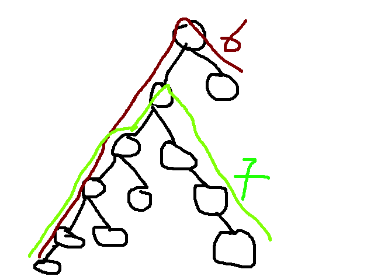

# 3 Java solutions with explanation | O(n) 100% fast

**Author:** Shahbaz_07
**Votes:** 97
**Link:** [https://leetcode.com/problems/diameter-of-binary-tree/solutions/1039281/](https://leetcode.com/problems/diameter-of-binary-tree/solutions/1039281/)

---

Only 3 cases occur while finding diameter:
* the maximum diameter lies in left sub tree entirely (as in the below image)
* the maximum diameter lies in right sub tree entirely
* the maximum diameter passes through the root node(height of lhs +height of rhs+2)




**Method 1: Intuitive | O(n^2) | Recursion inside recursion**

```
//O(n^2) complexity because we are making recursive call to height inside the recursive calls of diameter.
    public int diameterOfBinaryTree(TreeNode root) {  
        if(root==null)return 0;
        int lhs=diameterOfBinaryTree(root.left);
        int rhs=diameterOfBinaryTree(root.right);
        
        return Math.max(height(root.left)+height(root.right)+2, Math.max(lhs, rhs));
    }
    public int height(TreeNode root){
        if(root==null)return -1;
        
        int lhs=height(root.left);
        int rhs=height(root.right);
        
        return Math.max(lhs, rhs)+1;
    }
```


**Method 2: O(n) recursive solution | making a single recursive call and computing diameter and height simultaneously.**


```
class Solution {
    public int diameterOfBinaryTree(TreeNode root) {
        if(root==null)return 0;
   
        DiaPair ans=findDiameter(root);
        
        return ans.diameter;
    }
    
    public DiaPair findDiameter(TreeNode root ){  //O(n)
        if(root==null){
            return new DiaPair(-1, 0);
        }
        
        DiaPair lhs=findDiameter(root.left);
        DiaPair rhs=findDiameter(root.right);
        
        DiaPair myPair=new DiaPair();
        myPair.diameter=Math.max(lhs.height+rhs.height+2, Math.max(lhs.diameter, rhs.diameter));
        myPair.height=Math.max(lhs.height, rhs.height)+1;
        
        return myPair;
    }
}
class DiaPair{
    int height;
    int diameter;
    
    public DiaPair(){}
    
    public DiaPair(int height, int diameter){
        this.height=height;
        this.diameter=diameter;
    }
}
```


**Method 3: Clean O(n) solution without custom class**
* Find sum of height of LST+ RST (find global max)
* For\xA0every\xA0node, length of longest path which\xA0pass it\xA0= MaxDepth of its left subtree + MaxDepth of its right subtree+2.
```
    int ans=0;
    public int diameterOfBinaryTree(TreeNode root) {
        if(root==null )return 0;
        height(root);
        return ans;
    }
    
    public int height(TreeNode root){
        //if root==null height==0
        if(root==null)return -1;
        
        int L=height(root.left);
        int R=height(root.right);
        //ans signfies(no. of nodes farthest apart) or the DIAMETER
        ans=Math.max(ans,L+R+2);
        //height of the tree is max of LST & RST +1
        return 1+Math.max(L,R);
    }
```