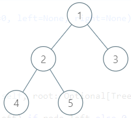
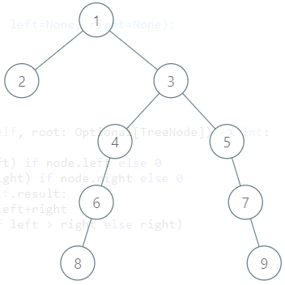
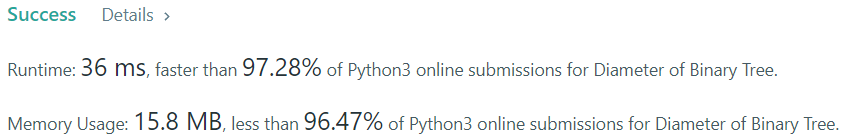

# Python Easy-to-understand solution w Explanation

**Author:** zayne-siew
**Votes:** 313
**Link:** [https://leetcode.com/problems/diameter-of-binary-tree/solutions/1515564/](https://leetcode.com/problems/diameter-of-binary-tree/solutions/1515564/)

---

### Introduction
Consider the first given example in the problem description:



The maximum depth of the left side of the tree is 2 (1 -> 2 -> 4/5), while the maximum depth of the right side of the tree is 1 (1 -> 3). This, coincidentally, matches well with the given diameter, since we can traverse from the leaf node(s) of one side of the tree to the leaf node(s) of the other side of the tree to obtain the diameter (for example, 3 -> 1 -> 2 -> 4).

---

### Idea 1

The diameter of a given tree is the **maximum depth of the left side of the tree**, plus the **maximum depth of the right side of the tree**. We can write the following pseudocode:

```python
# depth() is a pseudocode function we have to implement later
diameter = depth(root.left) + depth(root.right)
```

To actually write this, we need to find the maximum depth of a given tree. This is simple; for any given tree, we can find the maximum depth of the left side of the tree, the maximum depth of the right side of the tree, and +1 to the maximum of the two depths.

```python
def depth(node: Optional[TreeNode]) -> int:
    """
	To find the maximum depth of a given tree.
	:param node: The (root) node of the tree.
	:returns: The maximum depth of the tree, at the specified node.
	"""
	# return 1 + max(depth(node.left), depth(node.right)) if node else 0  # one-liner
	if not node:
	    return 0  # the depth of a non-existent node is 0
	left = depth(node.left)  # get the depth of the left side of the tree
	right = depth(node.right)  # get the depth of the right side of the tree
	return 1 + max(left, right)  # take the maximum, and +1 for the current node
```

We now have everything our pseudocode needs. To put it all together, make sure that we are calculating the diameter from the root node, not the depth.

```python
# Idea 1 Implementation!
class Solution:
    def diameterOfBinaryTree(self, root: TreeNode) -> int:
	    # Implement depth
	    def depth(node: Optional[TreeNode]) -> int:
		    return 1 + max(depth(node.left), depth(node.right)) if node else 0
		return depth(root.left) + depth(root.right)  # calculate diameter
```

And that's it! Run the code and... WA. >:)

---

### Idea 2

As it turns out, the maximum diameter of a given tree **need not involve the root node of the tree**. That means, if we only calculated the diamter of a tree from the root node, as our 1st implementation does, we might miss out on another pathway that does not pass through the root node but has a longer diameter. To visualise this, consider the following tree:



If we were to calculate the diameter as per the 1st implementation, the diameter would be 5 (2 -> 1 -> 3 -> 4 -> 6 -> 8). At first glance, this might seem correct, but there is actually a longer pathway with diameter 6 (9 -> 7 -> 5 -> 3 -> 4 -> 6 -> 8)! This is a problem for our 1st implementation since we assume the left side of the tree is involved with the diameter calculation.

The solution? We need to **calculate the diameter at each node and find the maximum diameter**. This is a simple fix because we just need to account for diameter calculation per call of depth(). This guarantees that we loop through each node in the tree and find the maximum possible diameter.

Note that we **still need to calculate the depth as per 1st implementation**. Since the diameter formula requires the depth value, each node still needs to know the maximum depth of its left side and the maximum depth of its right side.

```python
class Solution:
    def __init__(self):
	    self.diameter = 0  # stores the maximum diameter calculated
	
    def depth(self, node: Optional[TreeNode]) -> int:
        """
        This function needs to do the following:
            1. Calculate the maximum depth of the left and right sides of the given node
            2. Determine the diameter at the given node and check if its the maximum
        """
        # Calculate maximum depth
        left = self.depth(node.left) if node.left else 0
        right = self.depth(node.right) if node.right else 0
        # Calculate diameter
        self.diameter = max(self.diameter, left + right)
        # Make sure the parent node(s) get the correct depth from this node
        return 1 + max(left, right)
    
    def diameterOfBinaryTree(self, root: TreeNode) -> int:
        self.depth(root)
        return self.diameter
```

---

### Final result




Please upvote if this has helped you! Appreciate any comments as well :)