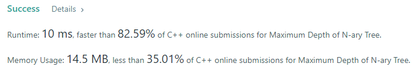
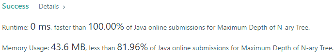
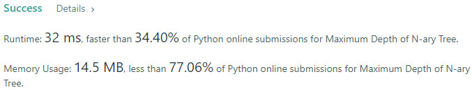
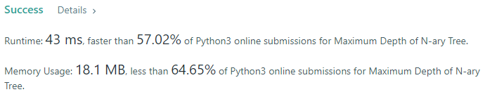
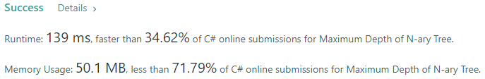
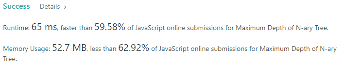
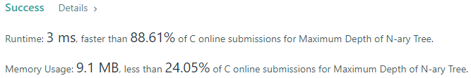

# 💢☠💫Easiest👾Faster✅💯 Lesser🧠 🎯 C++✅Python3🐍✅Java✅C✅Python🐍✅C#✅💥🔥💫Explained☠💥🔥 Beats 💯

**Author:** Edwards310
**Votes:** 4
**Link:** [https://leetcode.com/problems/maximum-depth-of-n-ary-tree/solutions/5659919/](https://leetcode.com/problems/maximum-depth-of-n-ary-tree/solutions/5659919/)

---

# Intuition








```javascript []
//JavaScript Code
/**
 * // Definition for a _Node.
 * function _Node(val,children) {
 *    this.val = val;
 *    this.children = children;
 * };
 */

/**
 * @param {_Node|null} root
 * @return {number}
 */
var maxDepth = function(root) {
    if(root == undefined)
        return 0
    if(root.children.length === 0)
        return 1
    let ans = -1
    for(let node of root.children)
        ans = Math.max(ans, maxDepth(node) + 1)
    return ans
};
```
```C++ []
//C++ Code
/*
// Definition for a Node.
class Node {
public:
    int val;
    vector<Node*> children;

    Node() {}

    Node(int _val) {
        val = _val;
    }

    Node(int _val, vector<Node*> _children) {
        val = _val;
        children = _children;
    }
};
*/

class Solution {
public:
    int maxDepth(Node* root) {
        if (!root)
            return 0;
        if (root->children.size() == 0)
            return 1;
        int ans = INT_MIN;
        for (auto node : root->children)
            ans = fmax(ans, maxDepth(node) + 1);
        return ans;
    }
};
```
```Python3 []
#Python3 Code
"""
# Definition for a Node.
class Node:
    def __init__(self, val=None, children=None):
        self.val = val
        self.children = children
"""

class Solution:
    def maxDepth(self, root: 'Node') -> int:
        if not root:
            return 0
        if len(root.children) == 0:
            return 1
        n = -1
        for node in root.children:
            n = max(n, self.maxDepth(node) + 1)
        return n
```
```Java []
//Java Code
/*
// Definition for a Node.
class Node {
    public int val;
    public List<Node> children;

    public Node() {}

    public Node(int _val) {
        val = _val;
    }

    public Node(int _val, List<Node> _children) {
        val = _val;
        children = _children;
    }
};
*/

class Solution {
    public int maxDepth(Node root) {
        if(root == null)
            return 0;
        if(root.children.size() == 0)
            return 1;
        int ans = Integer.MIN_VALUE;
        for(Node node : root.children)
            ans = Math.max(ans, maxDepth(node) + 1);
        return ans;
    }
}
```
```C []
//C Code
/**
 * Definition for a Node.
 * struct Node {
 *     int val;
 *     int numChildren;
 *     struct Node** children;
 * };
 */

int maxDepth(struct Node* root) {
    if(!root)
        return 0;
    if(root->numChildren == 0)
        return 1;
    int ans = -1;
    for(int i = 0; i < root->numChildren; ++i)
        ans = fmax(ans, maxDepth(root->children[i]) + 1);
    return ans;
    
}
```
```Python []
#Python Code
"""
# Definition for a Node.
class Node(object):
    def __init__(self, val=None, children=None):
        self.val = val
        self.children = children
"""

class Solution(object):
    def maxDepth(self, root):
        """
        :type root: Node
        :rtype: int
        """
        if not root:
            return 0
        if len(root.children) == 0:
            return 1
        n = -1
        for node in root.children:
            n = max(n, self.maxDepth(node) + 1)
        return n
```
```C# []
//C# Code
/*
// Definition for a Node.
public class Node {
    public int val;
    public IList<Node> children;

    public Node() {}

    public Node(int _val) {
        val = _val;
    }

    public Node(int _val, IList<Node> _children) {
        val = _val;
        children = _children;
    }
}
*/

public class Solution {
    public int MaxDepth(Node root) {
        if(root == null)
            return 0;
        if(root.children.Count() == 0)
            return 1;
        int ans = -1;
        foreach(Node node in root.children)
            ans = Math.Max(ans, MaxDepth(node) + 1);
        return ans;
    }
}
```

<!-- Describe your first thoughts on how to solve this problem. -->

# Approach
<!-- Describe your approach to solving the problem. -->

# Complexity
- Time complexity:
<!-- Add your time complexity here, e.g. $$O(n)$$ -->
      O(N)
- Space complexity:
<!-- Add your space complexity here, e.g. $$O(n)$$ -->
      O(N)
# Code


