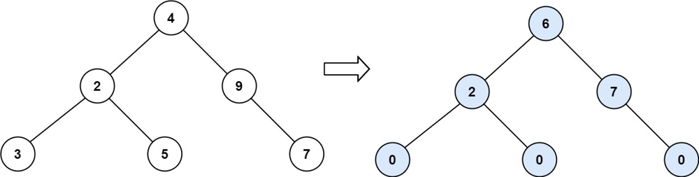
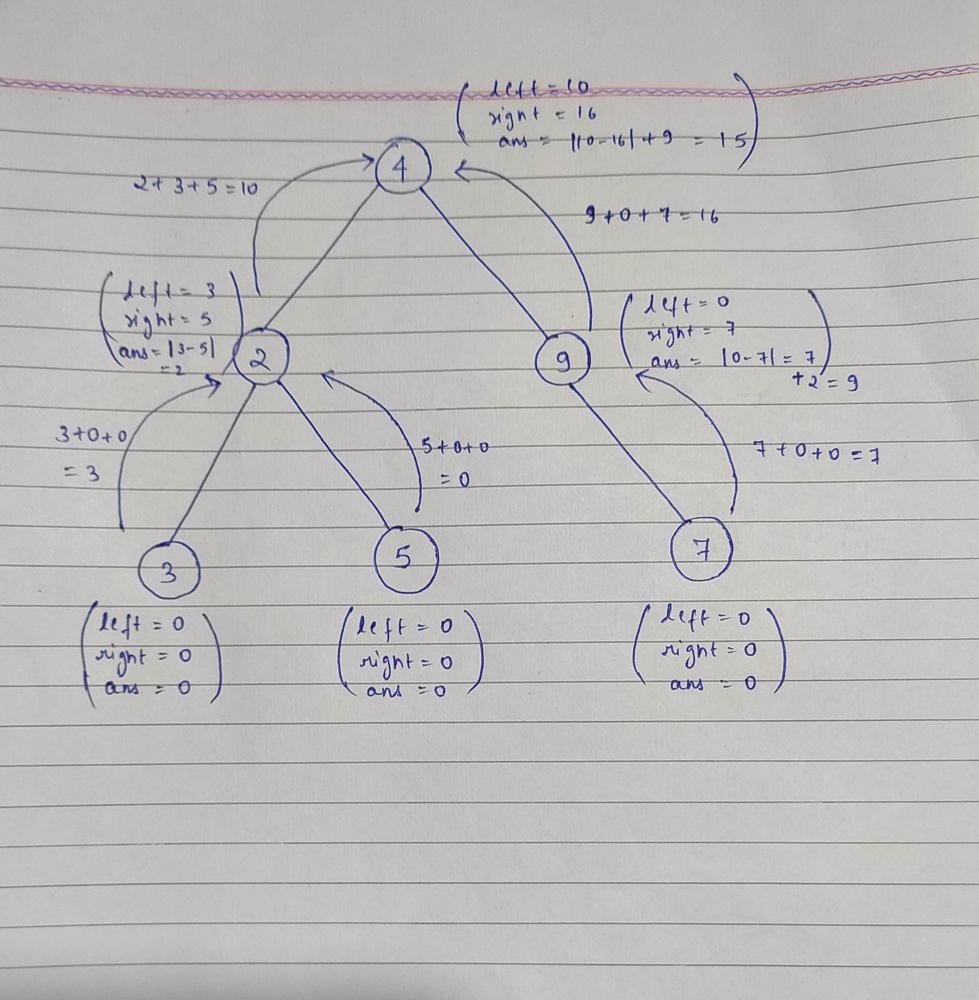

# JAVA | Brute Force to Optimization | PostOrder | Detailed Explanation Using Image

**Author:** Chaitanya1706
**Votes:** 28
**Link:** [https://leetcode.com/problems/binary-tree-tilt/solutions/1617355/](https://leetcode.com/problems/binary-tree-tilt/solutions/1617355/)

---

**Intution:** The idea is to find the sum of left and rigt subtree at every node and and keep adding their absolute diffrence
Example:


Tilt of node 3 : |0-0| = 0 (no children)
Tilt of node 5 : |0-0| = 0 (no children)
Tilt of node 7 : |0-0| = 0 (no children)
Tilt of node 2 : |3-5| = 2 
Tilt of node 9 : |0-7| = 7 
Tilt of node 4 : |(3+5+2)-(9+7)| = |10-16| = 6

**Approach1: Brute Force(Finding Sum at every Node)** 
**Explanation:** Find the sum of left subtree and right subtree using findSum function and take its absolute difference. So we will return the sum of absolute diff and leftSubtree tilt and right subtree tilt which will be your total tilt of the tree.

```
class Solution {
    int findSum(TreeNode root){
        if(root==null) return 0;
        return root.val + findSum(root.left) + findSum(root.right);
    }
    public int findTilt(TreeNode root) {
        if(root==null) return 0;
        
        int left = findTilt(root.left);
        int right = findTilt(root.right);
        
        return Math.abs(findSum(root.left)-findSum(root.right))+left+right;
        
    }
}

```

**Approach2: PostOrder Traversal**
**Explanation:** During PostOrder Traversal do both the work together, return the total sum and store the tilt value in a global variable.



```
class Solution {
    
    int ans = 0;

    public int findTilt(TreeNode root) {
        postOrder(root);
        return ans;
        
    }
    
    int postOrder(TreeNode root){
        if(root==null) return 0;
        
        int left = postOrder(root.left);
        int right = postOrder(root.right);
        
        ans += Math.abs(left-right);
        
        return root.val+ left + right;
        
        
    }
}
```