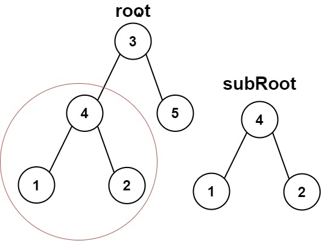
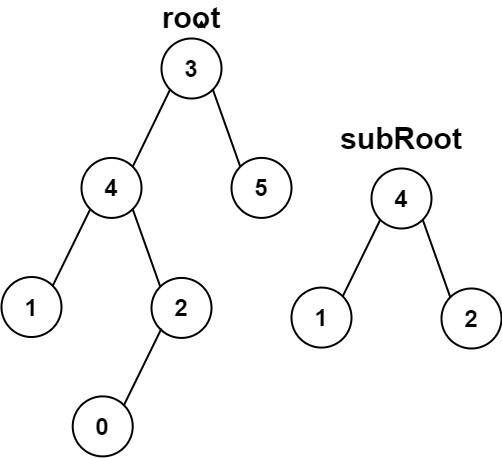

# [572. Subtree of Another Tree](https://leetcode.com/problems/subtree-of-another-tree/)

| Category | Difficulty | Likes | Dislikes |
| :------: | :--------: | :---: | :------: |
| Algorithms | Easy | 8774 | 592 |

**Tags:** [`tree`](https://leetcode.com/tag/tree), [`depth-first-search`](https://leetcode.com/tag/depth-first-search), [`string-matching`](https://leetcode.com/tag/string-matching), [`binary-tree`](https://leetcode.com/tag/binary-tree), [`hash-function`](https://leetcode.com/tag/hash-function)

**Companies:** `amazon`, `google`, `facebook`, `microsoft`, `ebay`

## Description

Given the roots of two binary trees `root` and `subRoot`, return `true` if there is a subtree of `root` with the same structure and node values of` subRoot` and `false` otherwise.

A subtree of a binary tree `tree` is a tree that consists of a node in `tree` and all of this node's descendants. The tree `tree` could also be considered as a subtree of itself.

 

**Example 1:**


```

Input: root = [3,4,5,1,2], subRoot = [4,1,2]
Output: true

```

**Example 2:**


```

Input: root = [3,4,5,1,2,null,null,null,null,0], subRoot = [4,1,2]
Output: false

```

 

**Constraints:**

	- The number of nodes in the `root` tree is in the range `[1, 2000]`.

	- The number of nodes in the `subRoot` tree is in the range `[1, 1000]`.

	- `-10^4 <= root.val <= 10^4`

	- `-10^4 <= subRoot.val <= 10^4`

---

**Links:** [Submissions](https://leetcode.com/problems/subtree-of-another-tree/) | [Solutions](https://leetcode.com/problems/subtree-of-another-tree/)
