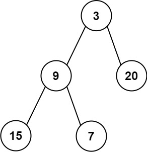

# [637. Average of Levels in Binary Tree](https://leetcode.com/problems/average-of-levels-in-binary-tree/)

| Category | Difficulty | Likes | Dislikes |
| :------: | :--------: | :---: | :------: |
| Algorithms | Easy | 5523 | 351 |

**Tags:** [`tree`](https://leetcode.com/tag/tree), [`depth-first-search`](https://leetcode.com/tag/depth-first-search), [`breadth-first-search`](https://leetcode.com/tag/breadth-first-search), [`binary-tree`](https://leetcode.com/tag/binary-tree)

**Companies:** `google`, `facebook`

## Description

Given the `root` of a binary tree, return *the average value of the nodes on each level in the form of an array*. Answers within `10^-5` of the actual answer will be accepted.

 

**Example 1:**


```

Input: root = [3,9,20,null,null,15,7]
Output: [3.00000,14.50000,11.00000]
Explanation: The average value of nodes on level 0 is 3, on level 1 is 14.5, and on level 2 is 11.
Hence return [3, 14.5, 11].

```

**Example 2:**


```

Input: root = [3,9,20,15,7]
Output: [3.00000,14.50000,11.00000]

```

 

**Constraints:**

	- The number of nodes in the tree is in the range `[1, 10^4]`.

	- `-2^31 <= Node.val <= 2^31 - 1`

---

**Links:** [Submissions](https://leetcode.com/problems/average-of-levels-in-binary-tree/) | [Solutions](https://leetcode.com/problems/average-of-levels-in-binary-tree/)
