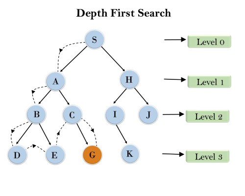
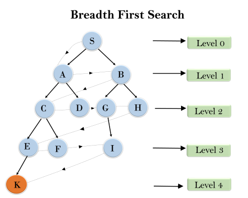

# Two Simple Ways To Do   |   DFS  and  BFS    |  C + +  ⚡️

**Author:** megamind_
**Votes:** 26
**Link:** [https://leetcode.com/problems/average-of-levels-in-binary-tree/solutions/2517018/](https://leetcode.com/problems/average-of-levels-in-binary-tree/solutions/2517018/)

---

**Approach #1 :** ***Depth First Search*** 
This can be done by applying dfs and keeping track of the current depth . We will keep a sum of elements at a particular depth and will also store the no. of elements encounter for a  depth.
.
.

.
.

```
 vector<pair<long,int>> count;       //  stores ( sum of a level , no of elements in that level)
    void dfs(TreeNode* root,int depth){     
        if(!root)return;
        int a = root->val;
        if(count.size()<=depth){             // to check if we have any entry corresponding to current depth 
            count.push_back({a,1});           //  if  we are at depth 1 and only depth 0 is completed then count.size()=1
        }
        else{
            count[depth].first += a;
            count[depth].second++;
        }
        dfs(root->left,depth+1);
        dfs(root->right,depth+1);    
    }
	
    vector<double> averageOfLevels(TreeNode* root) {  
        count.clear();
        dfs(root,0);
        vector<double> ans;
        for(int i=0;i<count.size();i++){
            ans.push_back((double)count[i].first/count[i].second);    // pushing in averages
        }
        return ans;
        
    }
```
.
.
.
**Approach #2 :** ***Breadth First Search/Level Order Traversal*** 
This can also be done by traversing level by level , we again need to store the sum and count of a level .As soon as a level ends, (which we get to know by encountering `NULL`) we push in the average and initialize sum and count of elements again for next level.
.
.

.
.

```
        vector<double> ans;
        queue<TreeNode*> q;
        q.push(root);
        q.push(NULL);                  // to mark end of a level 
        long long sum =0,count = 0;
        while(q.size()){
            TreeNode* cur = q.front();
            q.pop();
            if(!cur){
                ans.push_back((double)sum/count);     //  pushing in averages
                sum = 0,count = 0;
                q.push(NULL);
                if(!q.front())break;
            }
            else{
                count++;
                sum += cur->val;
                if(cur->left)q.push(cur->left);
                if(cur->right)q.push(cur->right);
            }
        }
 
        return ans;
```

.
.
***Thanks!***