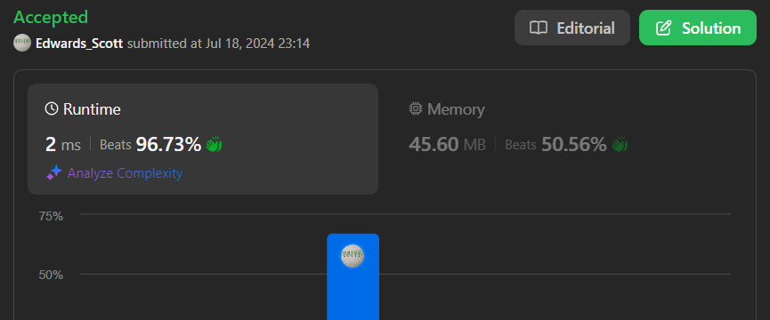

# 💢☠💫Easiest👾Faster✅💯 Lesser🧠 🎯 C++✅Python3🐍✅Java✅C✅Python🐍✅C#✅💥🔥💫Explained☠💥🔥 Beats 💯

**Author:** Edwards310
**Votes:** 6
**Link:** [https://leetcode.com/problems/average-of-levels-in-binary-tree/solutions/5500612/](https://leetcode.com/problems/average-of-levels-in-binary-tree/solutions/5500612/)

---

# Intuition


```C++ []
/**
 * Definition for a binary tree node.
 * struct TreeNode {
 *     int val;
 *     TreeNode *left;
 *     TreeNode *right;
 *     TreeNode() : val(0), left(nullptr), right(nullptr) {}
 *     TreeNode(int x) : val(x), left(nullptr), right(nullptr) {}
 *     TreeNode(int x, TreeNode *left, TreeNode *right) : val(x), left(left), right(right) {}
 * };
 */
class Solution {
public:
    vector<double> averageOfLevels(TreeNode* root) {
        if(!root)
            return {};
        vector<double> ans;
        queue<TreeNode*> q;
        q.push(root);
        while(!q.empty()){
            int n = q.size();
            double sum = 0;
            for(int i = 0; i < n; ++i){
                TreeNode* node = q.front();
                q.pop();
                sum += node->val;
                if(node->left)
                    q.push(node->left);
                if(node->right)
                    q.push(node->right);
            }
            ans.push_back(sum / n);
        }
        return ans;      
    }
};
```
```python3 []
# Definition for a binary tree node.
# class TreeNode:
#     def __init__(self, val=0, left=None, right=None):
#         self.val = val
#         self.left = left
#         self.right = right
class Solution:
    def averageOfLevels(self, root: Optional[TreeNode]) -> List[float]:
        if not root:
            return []
        res = []
        q = collections.deque()
        q.append(root)
        while q:
            q_len = len(q)
            sm = 0
            for i in range(q_len):
                node = q.popleft()
                sm += node.val
                if node.left:
                    q.append(node.left)
                if node.right:
                    q.append(node.right)
            res.append(sm/q_len)
        return res
```
```C []
/**
 * Definition for a binary tree node.
 * struct TreeNode {
 *     int val;
 *     struct TreeNode *left;
 *     struct TreeNode *right;
 * };
 */
/**
 * Note: The returned array must be malloced, assume caller calls free().
 */
typedef struct TreeNode node;
double* averageOfLevels(struct TreeNode* root, int* returnSize){
    double* arr = (double*)malloc(sizeof(double)*10001);
    int x = 0;
    node* queue[10001];
    int rear = 0, front = 0;
    queue[rear++] = root;
    while(front < rear){
        int curr = rear - front;
        double ans = 0;
        for(int j = 0; j < curr; ++j){
            node* temp = queue[front++];
            ans += temp->val;
            if(temp->left)
                queue[rear++] = temp->left;
            if(temp->right)
                queue[rear++] = temp->right;
        }
        arr[x++] = ans / curr;
    }
    *returnSize = x;
    return arr;
}
```
```Java []
/**
 * Definition for a binary tree node.
 * public class TreeNode {
 *     int val;
 *     TreeNode left;
 *     TreeNode right;
 *     TreeNode() {}
 *     TreeNode(int val) { this.val = val; }
 *     TreeNode(int val, TreeNode left, TreeNode right) {
 *         this.val = val;
 *         this.left = left;
 *         this.right = right;
 *     }
 * }
 */
class Solution {
    public List<Double> averageOfLevels(TreeNode root) {
        List<Double> res = new ArrayList<>();
        Queue<TreeNode> q = new LinkedList<>();
        q.add(root);
        while(!q.isEmpty()){
            int n = q.size();
            double ans = 0;
            for(int j = 0; j < n; ++j){
                TreeNode node = q.poll();
                ans += node.val;
                if(node.left != null)
                    q.add(node.left);
                if(node.right != null)
                    q.add(node.right);
            }
            res.add(ans / n);
        }
        return res;
    }
}
```
```python []
# Definition for a binary tree node.
# class TreeNode(object):
#     def __init__(self, val=0, left=None, right=None):
#         self.val = val
#         self.left = left
#         self.right = right
class Solution(object):
    def averageOfLevels(self, root):
        """
        :type root: TreeNode
        :rtype: List[float]
        """
        levels = []
        ret = []

        def helper(node, level):
            if not node:
                return 
            if len(levels) ==  level:
                levels.append([])
            helper(node.left, level + 1)
            levels[level].append(node.val)
            helper(node.right, level + 1)
        
        helper(root, 0)

        for level in levels:
            _sum = sum(level)
            ret.append(float(float(_sum) / len(level)))
        return ret
```

<!-- Describe your first thoughts on how to solve this problem. -->

# Approach
<!-- Describe your approach to solving the problem. -->

# Complexity
- Time complexity:
<!-- Add your time complexity here, e.g. $$O(n)$$ -->

- Space complexity:
<!-- Add your space complexity here, e.g. $$O(n)$$ -->

# Code
```
# Definition for a binary tree node.
# class TreeNode(object):
#     def __init__(self, val=0, left=None, right=None):
#         self.val = val
#         self.left = left
#         self.right = right
class Solution(object):
    def averageOfLevels(self, root):
        """
        :type root: TreeNode
        :rtype: List[float]
        """
        levels = []
        ret = []

        def helper(node, level):
            if not node:
                return 
            if len(levels) ==  level:
                levels.append([])
            helper(node.left, level + 1)
            levels[level].append(node.val)
            helper(node.right, level + 1)
        
        helper(root, 0)

        for level in levels:
            _sum = sum(level)
            ret.append(float(float(_sum) / len(level)))
        return ret
```

