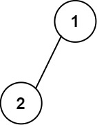
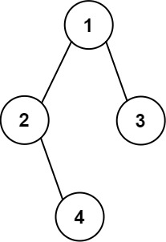

# [655. Print Binary Tree](https://leetcode.com/problems/print-binary-tree/)

| Category | Difficulty | Likes | Dislikes |
| :------: | :--------: | :---: | :------: |
| Algorithms | Medium | 555 | 468 |

**Tags:** [`tree`](https://leetcode.com/tag/tree), [`depth-first-search`](https://leetcode.com/tag/depth-first-search), [`breadth-first-search`](https://leetcode.com/tag/breadth-first-search), [`binary-tree`](https://leetcode.com/tag/binary-tree)

**Companies:** `google`, `amazon`, `poynt`

## Description

Given the `root` of a binary tree, construct a **0-indexed** `m x n` string matrix `res` that represents a **formatted layout** of the tree. The formatted layout matrix should be constructed using the following rules:

	- The **height** of the tree is `height` and the number of rows `m` should be equal to `height + 1`.

	- The number of columns `n` should be equal to `2^height+1 - 1`.

	- Place the **root node** in the **middle** of the **top row** (more formally, at location `res[0][(n-1)/2]`).

	- For each node that has been placed in the matrix at position `res[r][c]`, place its **left child** at `res[r+1][c-2^height-r-1]` and its **right child** at `res[r+1][c+2^height-r-1]`.

	- Continue this process until all the nodes in the tree have been placed.

	- Any empty cells should contain the empty string `""`.

Return *the constructed matrix *`res`.

 

**Example 1:**


```

Input: root = [1,2]
Output: 
[[&quot;&quot;,&quot;1&quot;,&quot;&quot;],
&nbsp;[&quot;2&quot;,&quot;&quot;,&quot;&quot;]]

```

**Example 2:**


```

Input: root = [1,2,3,null,4]
Output: 
[[&quot;&quot;,&quot;&quot;,&quot;&quot;,&quot;1&quot;,&quot;&quot;,&quot;&quot;,&quot;&quot;],
&nbsp;[&quot;&quot;,&quot;2&quot;,&quot;&quot;,&quot;&quot;,&quot;&quot;,&quot;3&quot;,&quot;&quot;],
&nbsp;[&quot;&quot;,&quot;&quot;,&quot;4&quot;,&quot;&quot;,&quot;&quot;,&quot;&quot;,&quot;&quot;]]

```

 

**Constraints:**

	- The number of nodes in the tree is in the range `[1, 2^10]`.

	- `-99 <= Node.val <= 99`

	- The depth of the tree will be in the range `[1, 10]`.

---

**Links:** [Submissions](https://leetcode.com/problems/print-binary-tree/) | [Solutions](https://leetcode.com/problems/print-binary-tree/)
