# Image Explanation🏆- [Why long to int ??] - C++/Java/Python

**Author:** aryan_0077
**Votes:** 156
**Link:** [https://leetcode.com/problems/maximum-width-of-binary-tree/solutions/3436593/](https://leetcode.com/problems/maximum-width-of-binary-tree/solutions/3436593/)

---

# Video Solution (`Aryan Mittal`) - Link in LeetCode Profile
`Maximum Width of Binary Tree` by `Aryan Mittal`


# Approach & Intution
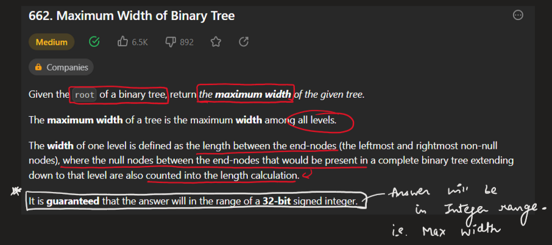
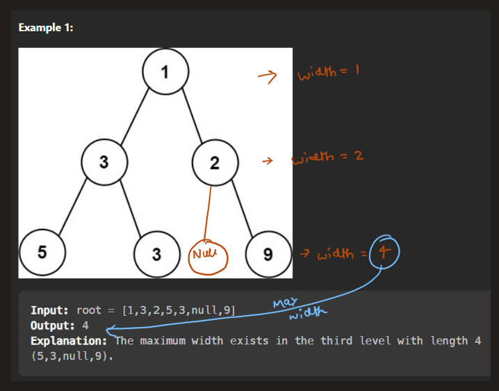
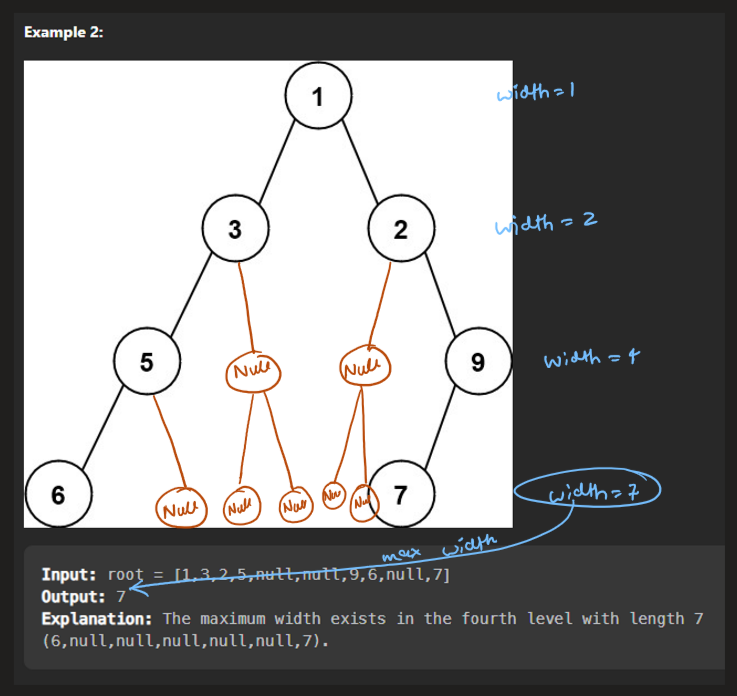
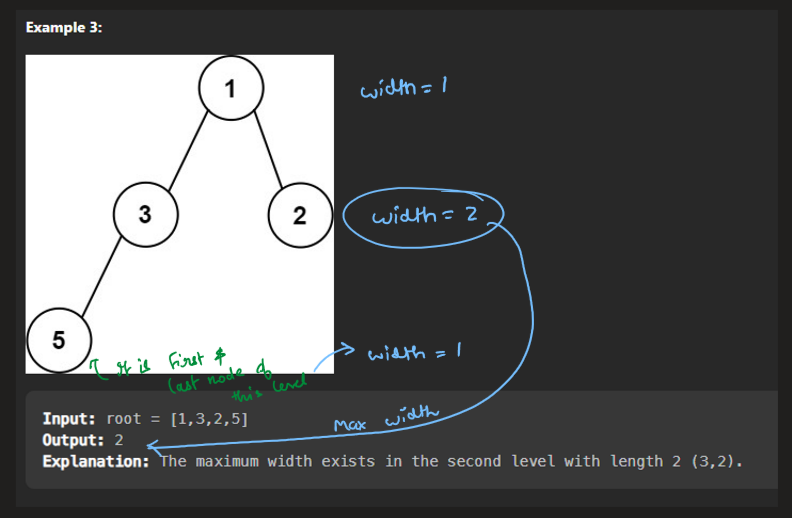
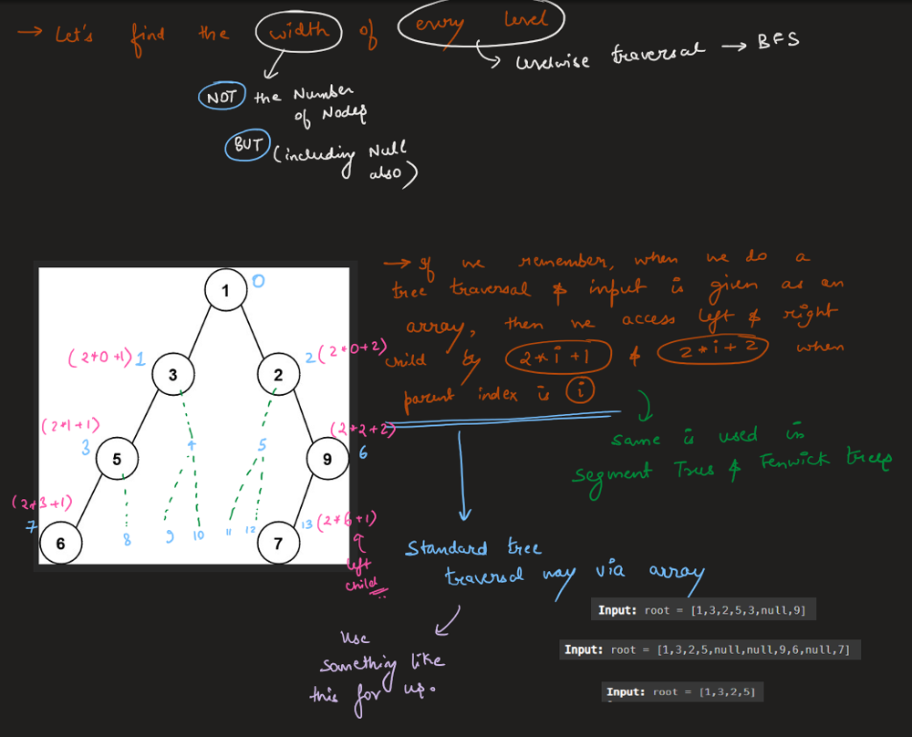
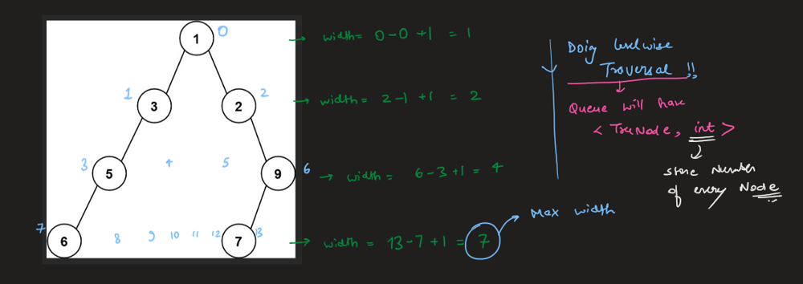
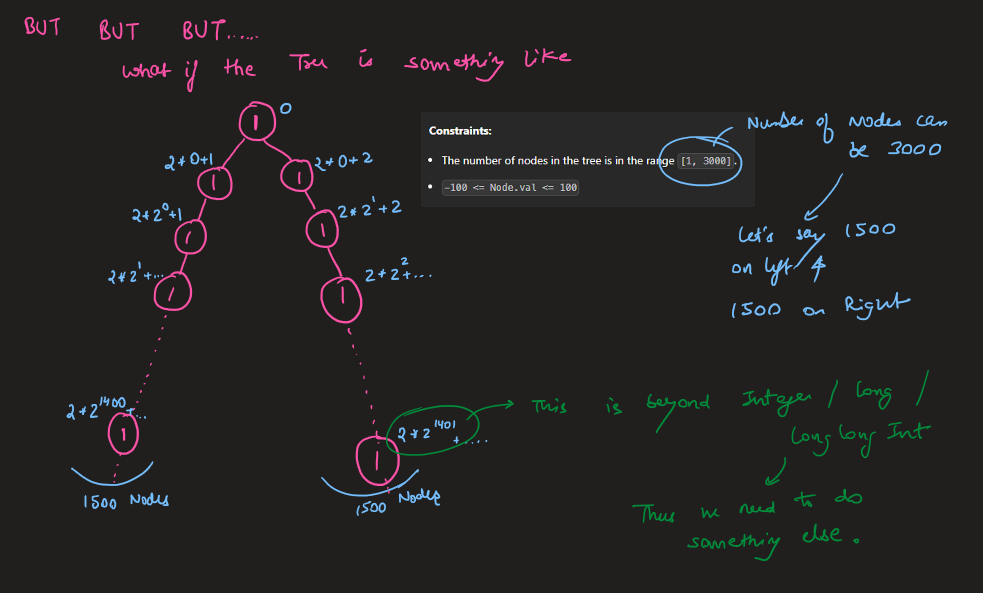
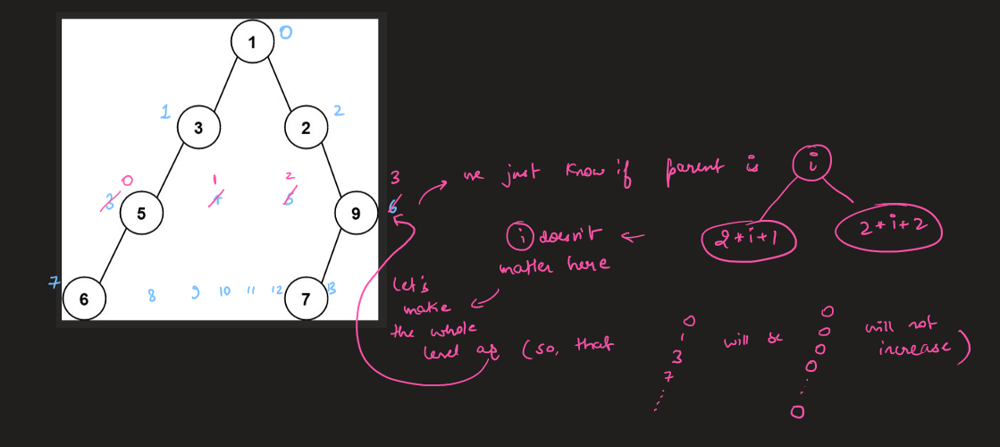
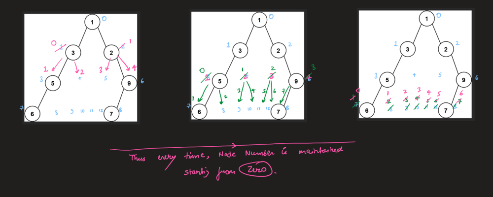
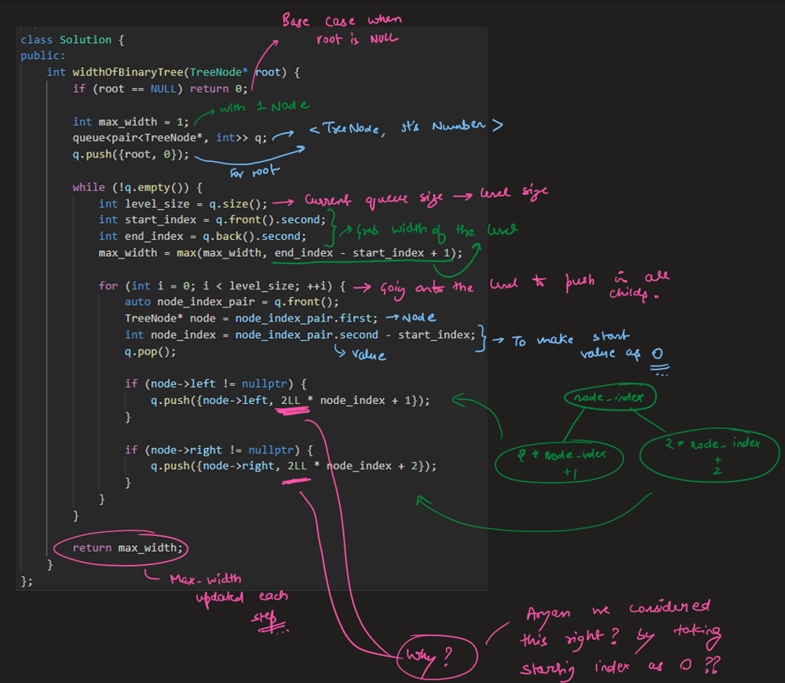
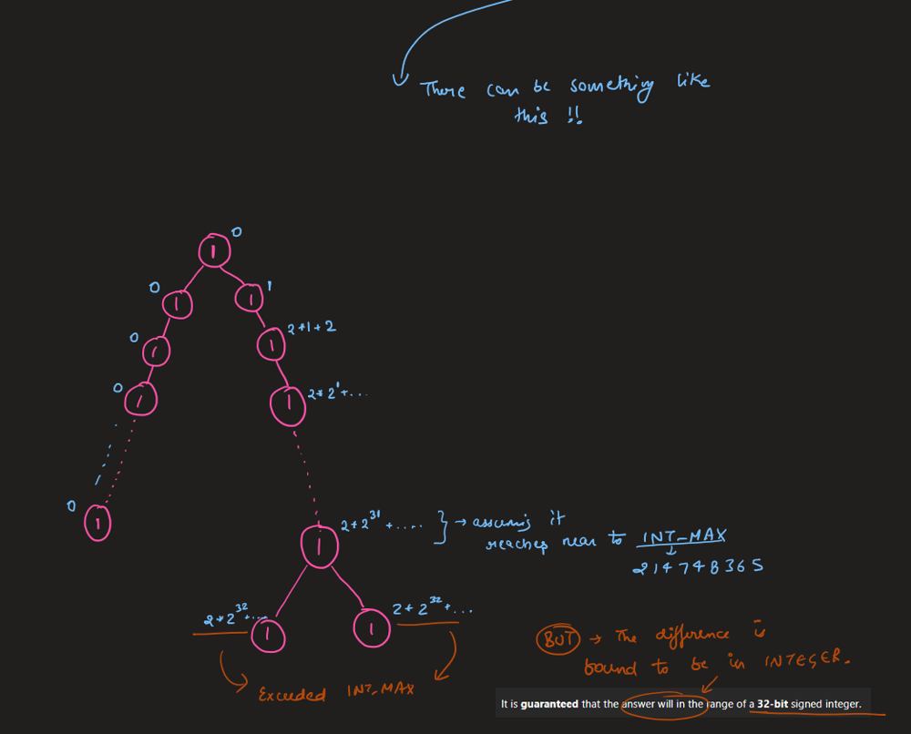
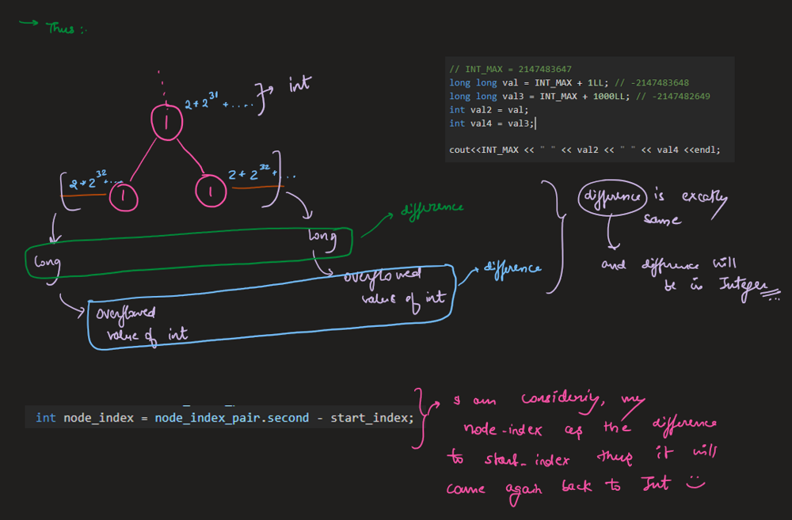


# Code
```C++ []
class Solution {
public:
    int widthOfBinaryTree(TreeNode* root) {
        if (root == NULL) return 0;
        
        int max_width = 1;
        queue<pair<TreeNode*, int>> q;
        q.push({root, 0});

        while (!q.empty()) {
            int level_size = q.size();
            int start_index = q.front().second;
            int end_index = q.back().second;
            max_width = max(max_width, end_index - start_index + 1);
            
            for (int i = 0; i < level_size; ++i) {
                auto node_index_pair = q.front();
                TreeNode* node = node_index_pair.first;
                int node_index = node_index_pair.second - start_index;
                q.pop();
                
                if (node->left != nullptr) {
                    q.push({node->left, 2LL * node_index + 1});
                }
                
                if (node->right != nullptr) {
                    q.push({node->right, 2LL * node_index + 2});
                }
            }
        }
        
        return max_width;
    }
};
```
```Java []
class Solution {
    public int widthOfBinaryTree(TreeNode root) {
        if (root == null) return 0;
        
        Queue<Pair<TreeNode, Integer>> queue = new LinkedList<>();
        queue.add(new Pair<>(root, 0));
        int maxWidth = 0;
        
        while (!queue.isEmpty()) {
            int levelLength = queue.size();
            int levelStart = queue.peek().getValue();
            int index = 0;
            
            for (int i = 0; i < levelLength; i++) {
                Pair<TreeNode, Integer> pair = queue.poll();
                TreeNode node = pair.getKey();
                index = pair.getValue();
                
                if (node.left != null) {
                    queue.add(new Pair<>(node.left, 2*index));
                }
                
                if (node.right != null) {
                    queue.add(new Pair<>(node.right, 2*index+1));
                }
            }
            
            maxWidth = Math.max(maxWidth, index - levelStart + 1);
        }
        
        return maxWidth;
    }
}
```
```Python []
class Solution:
    def widthOfBinaryTree(self, root: TreeNode) -> int:
        if not root:
            return 0
        
        queue = deque([(root, 0)])
        max_width = 0
        
        while queue:
            level_length = len(queue)
            _, level_start = queue[0]
            
            for i in range(level_length):
                node, index = queue.popleft()
                
                if node.left:
                    queue.append((node.left, 2*index))
                
                if node.right:
                    queue.append((node.right, 2*index+1))
                    
            max_width = max(max_width, index - level_start + 1)
            
        return max_width
```
