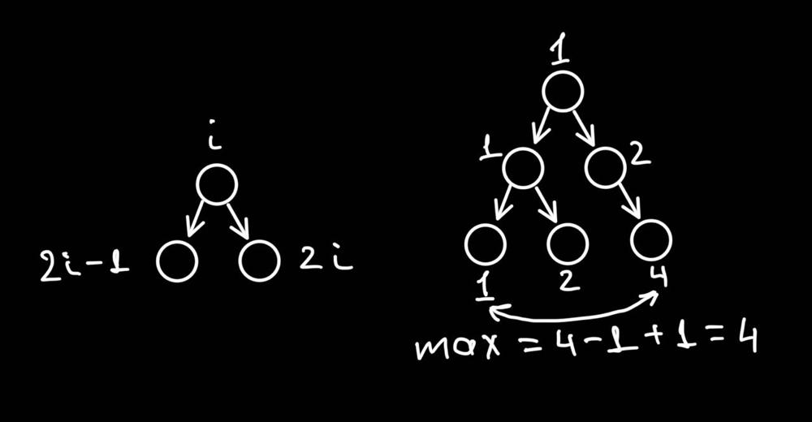

# ✅DFS Solution | Visualized Explanation | C# | Go✅

**Author:** shukhratutaboev
**Votes:** 40
**Link:** [https://leetcode.com/problems/maximum-width-of-binary-tree/solutions/3436503/](https://leetcode.com/problems/maximum-width-of-binary-tree/solutions/3436503/)

---

We will index all nodes with non zero indexing for all levels. Also we save min index of the level in hashtable.



# Approach
Depth First Search algorithm

# Complexity
- Time complexity: $$O(n)$$
<!-- Add your time complexity here, e.g. $$O(n)$$ -->

- Space complexity: $$O(depth)$$
<!-- Add your space complexity here, e.g. $$O(n)$$ -->

# Code
```Go []
func widthOfBinaryTree(root *TreeNode) int {
	set := make(map[int]int)

	return dfs(root, 1, 0, set)
}

func dfs(node *TreeNode, index, level int, set map[int]int) int {
	if node == nil {
		return 0
	}

	if _, ok := set[level]; !ok {
		set[level] = index
	}

	cur := index - set[level] + 1
	left := dfs(node.Left, index*2-1, level+1, set)
	right := dfs(node.Right, index*2, level+1, set)
	
	return max(cur, max(left, right))
}

func max(a, b int) int {
	if a > b {
		return a
	}

	return b
}
```
```C# []
public class Solution {
    public int WidthOfBinaryTree(TreeNode root) {
        var set = new Dictionary<int, int>();
        return DFS(root, 1, 0, set);
    }

    public int DFS(TreeNode node, int index, int level, Dictionary<int, int> set) {
        if (node == null) return 0;

        if (!set.ContainsKey(level)) {
            set[level] = index;
        }

        int cur = index - set[level] + 1;

        int left = DFS(node.left, index*2-1, level+1, set);
        int right = DFS(node.right, index*2, level+1, set);

        return Math.Max(cur, Math.Max(left, right));
    }
}
```
